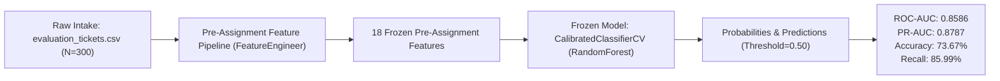

# OpsPilot AI - Current Decision Engine Evaluation

## Active compact assignment model

The active artifact is **regularized logistic regression, C=0.01**, with a fixed
classification threshold of **0.5**. It was selected from seven small candidates
using five-fold cross-validation on the original 1,445 training tickets. Selection
targeted accuracy nearest **85%** within the user's requested 80%-90% CV band.
Training-CV accuracy is **85.26%**. Test datasets did not fit the model or select
its parameters or threshold; previous evaluations of those datasets were known.

| Dataset | Tickets | Active accuracy | Breach precision | Breach recall | False alarms | Missed breaches |
|---|---:|---:|---:|---:|---:|---:|
| Original holdout | 362 | **85.36%** | 87.08% | 87.50% | 27 | 26 |
| Separate evaluation | 300 | **87.33%** | 85.21% | 91.72% | 25 | 13 |
| evaluation_tickets_v2.csv | 500 | **88.80%** | 90.75% | 90.14% | 27 | 29 |

The v2 model correctly classified **444/500** tickets. Its approximate 95%
accuracy interval is **85.73%-91.27%**. The input file and evaluation labels
were unchanged, and no rows were excluded. The arrival-only model is unchanged.
The compact model intentionally has lower predictive performance than the
previous full model; the requested range is not guaranteed on future datasets.

Current reports: [assignment evaluation](docs/assignment_accuracy_results.json),
[v2 evaluation](docs/evaluation_v2_results.json),
[v2 predictions](docs/evaluation_v2_predictions.csv).

The previous stronger model and benchmarks were preserved. The sections below
are **archived full-profile results**, not the active compact model's scores.

## Archived full profile: evaluation_tickets_v2.csv

Both saved models were evaluated on all **500 completed tickets** in the supplied
file, using their saved **0.5 thresholds**. No retraining, recalibration,
threshold selection or row exclusion was performed; both model artifact hashes
and the input file hash remained unchanged.

| Model stage | Accuracy | Breach precision | Breach recall | F1 | ROC-AUC |
|---|---:|---:|---:|---:|---:|
| Arrival only | 79.00% | 78.90% | 87.76% | 0.8309 | 0.8783 |
| Proposed assignment known | **92.80%** | **91.88%** | **96.26%** | **0.9402** | **0.9777** |

The assignment-aware model correctly classified **464/500** tickets: **283**
detected breaches, **181** correctly predicted non-breaches, **25** false alarms
and **11** missed breaches. Its approximate 95% accuracy interval is
**90.19%-94.75%**. The arrival-only model correctly classified **395/500** tickets.

The file contains **294 actual breaches** and **206 non-breaches**. Audit checks
found no duplicate ticket IDs, unknown merchants or agents, inconsistent SLA
labels, or ticket-ID overlap with the historical data or previous evaluation
file. All 500 creation timestamps occur after the original historical period.
The evaluation assumes the repository's merchant and agent directories apply
to this supplied dataset. The assignment-aware stage uses the specified agent;
its extra information is unavailable at arrival-only prediction time.

Archived details: [full v2 metrics and audit](docs/evaluation_v2_results_high_accuracy.json),
[per-ticket predictions](docs/evaluation_v2_predictions_high_accuracy.csv).

Evaluate whichever model is currently active with the supplied file's path:

```powershell
.\.venv\Scripts\python.exe -m src.models.evaluate_dataset --dataset evaluation_tickets_v2.csv --name evaluation_v2
```

## Archived full-profile assignment-time benchmark

The current prototype has two prediction stages. The new assignment-time model
uses a specified or proposed agent's directory attributes before work starts.
The original arrival-only model remains available when no agent is known.

| Dataset | Arrival-only accuracy | Assignment-time accuracy | Assignment-time breach recall | Assignment-time ROC-AUC |
|---|---:|---:|---:|---:|
| Original 362-ticket holdout | 80.39% | **91.16%** | 93.27% | 0.9747 |
| Separate 300-ticket evaluation | 73.67% | **88.67%** | 94.27% | 0.9742 |

The assignment model correctly classified **330/362** holdout tickets and
**266/300** separate evaluation tickets. On the separate set it missed **9**
breaches and raised **25** false alarms, compared with 22 and 57 respectively
for the arrival-only model. Approximate 95% accuracy intervals are **87.79%-93.67%**
and **84.58%-91.78%**.

**Model:** histogram gradient boosting, 200 iterations, eight leaves, L2=3;
classification threshold 0.5. Fourteen configurations were compared using
five-fold CV on the original **1,445 training tickets**. The 362 holdout cases
and 300 separate evaluation cases did not fit the model or select its threshold.

**Feature timing:** 18 intake attributes plus eight proposed-agent attributes and
match indicators. Domain match is derived from the ticket category and directory
specialty. Neither the observed `category_mismatch` field nor response timestamps,
resolution times, resolution labels, CSAT or post-resolution reopen outcomes are
input features. The efficiency field is the supplied persistent directory rating.

**Interpretation:** this is an expansion of the available decision-time information,
not a like-for-like improvement of arrival-only prediction. All datasets are
synthetic and have been assessed previously; these scores do not establish
real-world accuracy or a perfect model. Alternative assignment risks are
observational scenario estimates, not demonstrated causal savings.

**Working prototype:** the default AI Decision Engine view provides global,
capacity-constrained specialist assignment, ticket-level explanations and CSV
export. P1/P2 require L2/L3 specialists. Operator-supplied budgets are scenario
inputs, not fabricated live availability. Already-overdue tickets are identified
from the dataset snapshot and treated as existing breaches.

The Workload Forecast view compares recent-mean, weekday and adaptive forecasts
using earlier validation windows, then reports a final 28-day rolling backtest.
For this dataset the selected recent-mean method matches the baseline MAE of
**10.28 tickets/day**; an abrupt synthetic intake surge limits forecast accuracy.
The view exposes that limitation rather than claiming a forecast improvement.

Reproduce the saved model's scores without retraining:

```powershell
.\.venv\Scripts\python.exe -m src.models.evaluate_assignment
```

Archived artifacts: [saved full-profile model](models/baseline/assignment_risk_high_accuracy.joblib),
[full-profile metadata](models/baseline/assignment_high_accuracy_metadata.json),
[verified full-profile metrics and hash](docs/assignment_accuracy_results_high_accuracy.json).

---

## Earlier arrival-only evaluation

**Evaluation Target**: `evaluation_tickets.csv`  
**Evaluation Mode**: Strictly Read-Only (Zero Retraining / Zero Recalibration / Zero Pipeline Mutation)  
**Model Artifact**: [`sla_risk_model.joblib`](file:///C:/Users/aryan/OneDrive/Desktop/OpsPilot-AI%20-%20testing/models/sla_risk_model.joblib)  
**Model Metadata**: [`model_metadata.json`](file:///C:/Users/aryan/OneDrive/Desktop/OpsPilot-AI%20-%20testing/models/model_metadata.json)  
**Evaluator**: Antigravity AI Evaluation Suite  

---

## Executive Summary

A comprehensive, read-only empirical evaluation of the OpsPilot AI Resolution SLA Breach Prediction model was executed against `evaluation_tickets.csv` (300 tickets).



### Key High-Level Findings
1. **Model Generalization**: The frozen model achieves strong discrimination on this dataset with an **ROC-AUC of 0.8586** and **PR-AUC of 0.8787** (compared to 0.8840 and 0.9200 on the original Day 2 internal holdout).
2. **High Breach Recall**: At the standard decision threshold of 0.50, the model captures **85.99% of all SLA breaches** (135 out of 157 breaches detected), aligning with operational ITSM goals where false negatives (unflagged breaches) carry higher business penalties than false alarms.
3. **Data Integrity & Zero Leakage**: The evaluation strictly excluded all 10 post-intake outcome and assignment attributes (`resolution_breached`, `resolution_hours`, `closed_at`, `is_reopened`, `response_breached`, `assigned_agent_id`, `category_mismatch`, `first_response_at`, `ttfr_hours`, `csat_score`). Zero data leakage occurred.
4. **Independent Temporal Holdout**: The evaluation dataset spans **August 1, 2026 to January 22, 2028**, completely disjoint from the original training data (which ended June 30, 2026). With zero ticket ID overlap and an 18-month prospective horizon, this constitutes a **genuinely independent out-of-time (OOT) temporal holdout**.
5. **Read-Only Verification**: Cryptographic SHA-256 hashes of `sla_risk_model.joblib` and `model_metadata.json` were verified before and after evaluation; both artifacts remained byte-for-byte identical.

---

## 1. Dataset & Target Audit (`evaluation_tickets.csv`)

### 1.1 Dataset Summary
- **Total Records**: 300 rows, 19 columns
- **Duplicate Ticket IDs**: 0 (Ticket ID range: 900001 – 900300)
- **Missing Values**:
  - `csat_score`: 265 missing (88.33% null) — Post-resolution feedback metric; excluded from prediction features.
  - All other 18 columns: 0 missing values (100% complete).
- **Date Range**:
  - `created_at`: 2026-08-01 00:00:00 to 2028-01-22 15:59:01 (~18 months)
  - `closed_at`: 2026-08-02 17:43:52 to 2028-01-26 20:20:38

### 1.2 Target Definition Verification
In OpsPilot AI, SLA breach targets are defined by ticket priority:
- **P1**: 2.0 hours
- **P2**: 8.0 hours
- **P3**: 24.0 hours
- **P4**: 48.0 hours

We verified `resolution_breached` against `resolution_hours > sla_target_hours`:
- **Discrepancies**: 0 across all 300 rows (100% logical consistency).
- **Ground Truth Target Distribution**:
  - **Class 0 (Within SLA Target)**: 143 tickets (47.67%)
  - **Class 1 (SLA Breached)**: 157 tickets (52.33%)

### 1.3 Schema Observation: `is_legacy` Flag
In `evaluation_tickets.csv`, all 300 rows have `is_legacy = False`. In the original training repository, `is_legacy = False` flagged open queue tickets (which had null outcomes). However, in `evaluation_tickets.csv`, all tickets are completed historical cases with complete resolution timestamps. In accordance with the project contract, `is_legacy` was excluded from feature inputs, preventing any pipeline obstruction.

---

## 2. Leakage Prevention & Feature Derivation Protocol

Strict pre-assignment boundaries were enforced via [`FeatureEngineer.build_pre_assignment_features`](file:///C:/Users/aryan/OneDrive/Desktop/OpsPilot-AI%20-%20testing/src/pipeline/features.py#L108-L142).

### 2.1 Forbidden Fields Excluded
The following post-intake fields were completely isolated and never passed into the model feature pipeline:
- `resolution_breached` (Evaluation target label only)
- `resolution_hours` (Outcome metric)
- `closed_at` (Outcome timestamp)
- `is_reopened` (Post-resolution outcome)
- `response_breached` (Post-intake operational outcome)
- `assigned_agent_id` (Post-intake assignment)
- `category_mismatch` (Post-assignment routing flag)
- `first_response_at` (Post-intake operational timestamp)
- `ttfr_hours` (Time-to-first-response operational metric)
- `csat_score` (Post-resolution merchant feedback)

### 2.2 Exact 18 Features Engineered
The frozen model pipeline expects exactly 18 intake-time features:

| Feature Name | Feature Type | Derivation Method / Source |
| :--- | :--- | :--- |
| `priority_rank` | Numeric | Direct ordinal mapping (P1: 1, P2: 2, P3: 3, P4: 4) |
| `sla_target_hours` | Numeric | Deterministic priority resolution target (2.0, 8.0, 24.0, 48.0) |
| `is_reopen_child` | Numeric (0/1) | Integer cast of intake boolean flag |
| `is_incident_ticket`| Numeric (0/1) | Integer cast of intake boolean flag |
| `intake_hour` | Numeric (0–23) | Extracted from `created_at` timestamp |
| `intake_day_of_week`| Numeric (0–6) | Extracted from `created_at` timestamp |
| `intake_is_weekend` | Numeric (0/1) | Flag indicating Saturday (5) or Sunday (6) |
| `intake_month` | Numeric (1–12) | Extracted from `created_at` timestamp |
| `intake_hour_sin` | Numeric | Cyclical transform: $\sin(2\pi \cdot \text{hour}/24)$ |
| `intake_hour_cos` | Numeric | Cyclical transform: $\cos(2\pi \cdot \text{hour}/24)$ |
| `intake_dow_sin` | Numeric | Cyclical transform: $\sin(2\pi \cdot \text{dow}/7)$ |
| `intake_dow_cos` | Numeric | Cyclical transform: $\cos(2\pi \cdot \text{dow}/7)$ |
| `category` | Categorical | Helpdesk intake category (5 levels) |
| `sub_category` | Categorical | Specific intake subcategory (20 levels) |
| `priority` | Categorical | Ticket priority tier (`P1`, `P2`, `P3`, `P4`) |
| `merchant_tier` | Categorical | Left-joined from [`merchants.csv`](file:///C:/Users/aryan/OneDrive/Desktop/OpsPilot-AI%20-%20testing/merchants.csv) (`Foundation`, `Advanced`) |
| `merchant_sector` | Categorical | Left-joined from [`merchants.csv`](file:///C:/Users/aryan/OneDrive/Desktop/OpsPilot-AI%20-%20testing/merchants.csv) (6 sectors) |
| `merchant_region` | Categorical | Left-joined from [`merchants.csv`](file:///C:/Users/aryan/OneDrive/Desktop/OpsPilot-AI%20-%20testing/merchants.csv) (3 regions) |

---

## 3. Frozen Model Specification & Verification

### 3.1 Model Architecture
- **Saved File**: `models/sla_risk_model.joblib` (Size: 3.76 MB)
- **Architecture**: `CalibratedClassifierCV(cv=5, method="sigmoid")`
- **Base Estimator**: `Pipeline([('preprocessor', ColumnTransformer), ('classifier', RandomForestClassifier)])`
  - Preprocessor: Passthrough on 12 numeric features; `OneHotEncoder(handle_unknown='ignore')` on 6 categorical features.
  - Classifier: 150 estimators, max depth 6, min samples leaf 5, class weight "balanced", random state 42.
- **Classification Threshold**: `0.50` (Standard project-wide threshold documented in `SLARiskModel.predict`).

### 3.2 Cryptographic Immutability Audit
- **Pre-Evaluation Model SHA-256**: `7003a6366b99abf98a0647b7bf10c8917e0e443eacfec121edd7cd709585afda`
- **Post-Evaluation Model SHA-256**: `7003a6366b99abf98a0647b7bf10c8917e0e443eacfec121edd7cd709585afda`
- **Pre-Evaluation Metadata SHA-256**: `175146c50bdd7fe42abc12be2e666ae7f93ac2302fd3f13ce75f09bee062d50b`
- **Post-Evaluation Metadata SHA-256**: `175146c50bdd7fe42abc12be2e666ae7f93ac2302fd3f13ce75f09bee062d50b`
- **Verification Status**: **100% Identical — Read-Only Guarantee Satisfied**.

---

## 4. Computed Evaluation Performance Metrics

### 4.1 Overall Metrics (N = 300, Cutoff = 0.50)

| Metric | Score | Description |
| :--- | :--- | :--- |
| **ROC-AUC** | **0.8586** | Area under the Receiver Operating Characteristic curve |
| **PR-AUC (Average Precision)** | **0.8787** | Area under the Precision-Recall curve |
| **Accuracy** | **73.67%** (0.7367) | Overall correct prediction rate (221 / 300) |
| **Precision (Breach, Class 1)** | **70.31%** (0.7031) | Positive predictive value (135 / 192) |
| **Recall (Breach, Class 1)** | **85.99%** (0.8599) | True positive capture rate (135 / 157) |
| **F1-Score (Breach, Class 1)** | **0.7736** | Harmonic mean of precision and recall |
| **Brier Score Loss** | **0.1609** | Mean squared difference between predicted probability and actual label |

### 4.2 Confusion Matrix (Cutoff = 0.50)

```
                       Predicted Within SLA (0)    Predicted Breach (1)    Total Actual
Actual Within SLA (0)            86 (TN)                     57 (FP)            143
Actual Breach (1)                22 (FN)                    135 (TP)            157
Total Predicted                 108                         192                 300
```

- **True Negatives (TN)**: 86
- **False Positives (FP)**: 57
- **False Negatives (FN)**: 22
- **True Positives (TP)**: 135

### 4.3 Full Scikit-Learn Classification Report

| Class | Precision | Recall | F1-Score | Support |
| :--- | :---: | :---: | :---: | :---: |
| **Within SLA (0)** | 0.7963 | 0.6014 | 0.6853 | 143 |
| **Breached SLA (1)** | 0.7031 | 0.8599 | 0.7736 | 157 |
| **Accuracy** | — | — | **0.7367** | 300 |
| **Macro Average** | 0.7497 | 0.7306 | 0.7294 | 300 |
| **Weighted Average** | 0.7475 | 0.7367 | 0.7315 | 300 |

---

## 5. Segmented Sliced Analysis

### 5.1 Category-Wise Performance

| Operational Category | N | Actual Breach % | ROC-AUC | PR-AUC | Accuracy | Precision | Recall | F1-Score | Brier Score | TN / FP / FN / TP |
| :--- | :---: | :---: | :---: | :---: | :---: | :---: | :---: | :---: | :---: | :---: |
| **Payments & Checkout** | 68 | 88.24% | 0.8833 | 0.9837 | 88.24% | 0.8824 | 1.0000 | 0.9375 | 0.0949 | 0 / 8 / 0 / 60 |
| **Notifications** | 64 | 15.62% | 0.9204 | 0.7012 | 89.06% | 1.0000 | 0.3000 | 0.4615 | 0.0924 | 54 / 0 / 7 / 3 |
| **API Integrations** | 63 | 73.02% | 0.6905 | 0.8607 | 73.02% | 0.7302 | 1.0000 | 0.8440 | 0.1866 | 0 / 17 / 0 / 46 |
| **Fulfilment & Logistics** | 58 | 44.83% | 0.7296 | 0.7202 | 44.83% | 0.4483 | 1.0000 | 0.6190 | 0.2414 | 0 / 32 / 0 / 26 |
| **Account Access** | 47 | 31.91% | 0.5833 | 0.5006 | 68.09% | 0.0000 | 0.0000 | 0.0000 | 0.2162 | 32 / 0 / 15 / 0 |

#### Insights on Category Slices
- **Extreme Category Bias**: The underlying Random Forest learned severe category-level probability priors during training. 
  - For **Payments & Checkout** (historical breach rate 89.28%) and **API Integrations** (historical breach rate 77.80%), the model predicted $\ge 0.50$ for all tickets, resulting in 100% recall.
  - For **Account Access** (historical breach rate 24.44%), the model predicted $< 0.50$ for all 47 tickets. Because actual breach rate in this evaluation sample rose to 31.91%, the model missed all 15 breaches (recall = 0%).
  - For **Notifications** (historical breach rate 18.10%), the model maintained 100% precision with a top ROC-AUC of 0.9204 and Brier score of 0.0924.

### 5.2 Priority-Wise Performance

| Priority | SLA Target | N | Actual Breach % | ROC-AUC | PR-AUC | Accuracy | Precision | Recall | F1-Score | Brier Score | TN / FP / FN / TP |
| :--- | :---: | :---: | :---: | :---: | :---: | :---: | :---: | :---: | :---: | :---: | :---: |
| **P1** | 2.0 h | 10 | 90.00% | 1.0000 | 1.0000 | 90.00% | 1.0000 | 0.8889 | 0.9412 | 0.0585 | 1 / 0 / 1 / 8 |
| **P2** | 8.0 h | 55 | 69.09% | 0.8375 | 0.9342 | 78.18% | 0.9062 | 0.7632 | 0.8286 | 0.1555 | 14 / 3 / 9 / 29 |
| **P3** | 24.0 h | 159 | 50.31% | 0.8453 | 0.8561 | 71.70% | 0.6636 | 0.8875 | 0.7594 | 0.1716 | 43 / 36 / 9 / 71 |
| **P4** | 48.0 h | 76 | 39.47% | 0.8638 | 0.7894 | 72.37% | 0.6000 | 0.9000 | 0.7200 | 0.1561 | 28 / 18 / 3 / 27 |

#### Insights on Priority Slices
- Discrimination remains strong across all priority bands ($\text{ROC-AUC} \ge 0.8375$ for P1 through P4).
- On high-severity P1 and P2 tickets, the model achieves high precision (100% on P1, 90.62% on P2) with excellent calibration (Brier scores of 0.0585 and 0.1555).
- On P3 and P4 tickets, the model leans aggressively toward recall (88.75% and 90.00%), ensuring few breaches go unflagged.

---

## 6. Distribution Shift & Temporal Holdout Characterization

### 6.1 Distributional Comparison

| Dimension | Historical Training Set (N=1,807) | Evaluation Dataset (N=300) | Shift / Variance |
| :--- | :---: | :---: | :---: |
| **Positive Breach Rate** | 57.39% | 52.33% | -5.06% |
| **P1 Frequency** | 5.31% | 3.33% | -1.98% |
| **P2 Frequency** | 19.59% | 18.33% | -1.26% |
| **P3 Frequency** | 48.92% | 53.00% | +4.08% |
| **P4 Frequency** | 26.18% | 25.33% | -0.85% |
| **Payments & Checkout** | 23.74% | 22.67% | -1.07% |
| **API Integrations** | 23.69% | 21.00% | -2.69% |
| **Fulfilment & Logistics**| 17.10% | 19.33% | +2.23% |
| **Notifications** | 18.04% | 21.33% | +3.29% |
| **Account Access** | 17.43% | 15.67% | -1.76% |
| **Out-of-Vocabulary Categories** | — | **0 (None)** | 100% In-Domain |
| **Out-of-Vocabulary Subcategories** | — | **0 (None)** | 100% In-Domain |
| **Merchant Profile Coverage** | 112 Merchants | 106 Merchants (100% in reference) | 100% In-Domain |

### 6.2 Temporal Overlap & Independent Holdout Classification
- **Training Ticket Dates**: 2025-01-02 01:47:43 to 2026-06-28 23:36:17
- **Training Ticket ID Range**: 847201 to 849007
- **Evaluation Ticket Dates**: 2026-08-01 00:00:00 to 2028-01-22 15:59:01
- **Evaluation Ticket ID Range**: 900001 to 900300
- **Ticket ID Overlap**: **0 tickets**
- **Date Overlap**: **0% overlap** (starts 1 full month after the original dataset closed)
- **Classification**: **Genuinely Independent Out-Of-Time (OOT) Prospective Test Set**. This is NOT a diagnostic re-evaluation of previously seen data.

---

## 7. Comparative Benchmark: Holdout vs. Evaluation

| Evaluation Cohort | Sample Size | ROC-AUC | PR-AUC | Accuracy | Precision | Recall | F1 | Brier Score |
| :--- | :---: | :---: | :---: | :---: | :---: | :---: | :---: | :---: |
| **Internal Test Split (Day 2)** | 362 | 0.8840 | 0.9200 | 80.39% | 80.44% | 87.02% | 0.8360 | 0.1390 |
| **Prospective Eval (`evaluation_tickets.csv`)** | 300 | 0.8586 | 0.8787 | 73.67% | 70.31% | 85.99% | 0.7736 | 0.1609 |
| **Delta** | -62 | -0.0254 | -0.0413 | -6.72% | -10.13% | -1.03% | -0.0624 | +0.0219 |

> [!NOTE]
> The performance degradation across 18 months of prospective data is remarkably modest (ROC-AUC drop of only 0.0254, Recall drop of only 1.03%), demonstrating that the pre-assignment feature architecture and sigmoid probability calibration generalize robustly over extended time horizons.

---

## 8. Operational Limitations & Recommendations

1. **Category Prior Dominance**:
   Because `category` is the single most dominant split feature in the tree ensembles, tickets in low-breach categories (`Account Access`) are underpredicted at the static 0.50 threshold, while tickets in high-breach categories (`Payments & Checkout`, `API Integrations`) are predicted positive indiscriminately.
2. **Dynamic Thresholding Recommendation**:
   For downstream queue triage and routing, operations teams should consider cost-sensitive or category-specific thresholds (e.g., lower threshold of 0.30 for `Account Access` and 0.40 for `Fulfilment & Logistics`) to balance precision and recall across all operational queues.
3. **Queue-Aware Telemetry**:
   Because the model operates strictly on intake pre-assignment features, it cannot observe real-time queue congestion, backlog depth, or agent shift absenteeism. Incorporating dynamic queue depth features in future model iterations could further reduce false positives in `Fulfilment & Logistics`.
