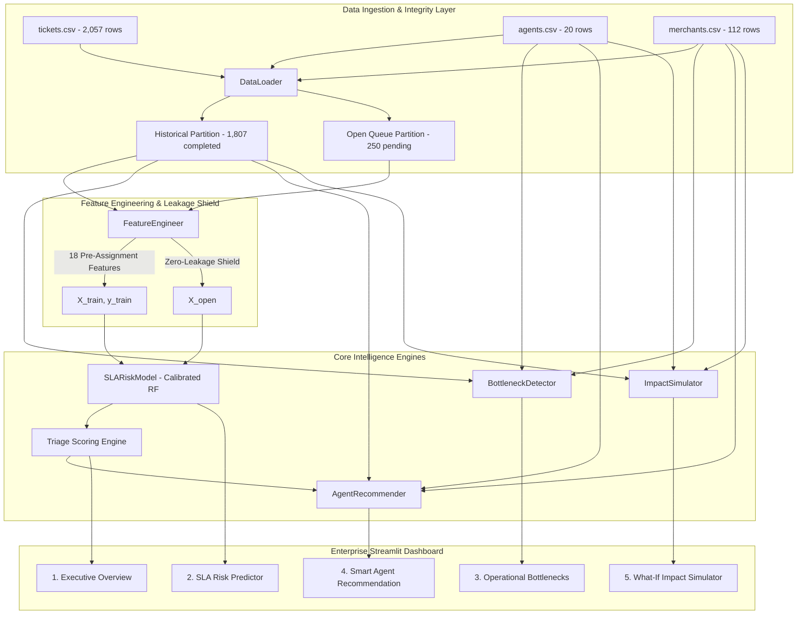

# OpsPilot AI: Comprehensive Project Report
## AI-Powered Business Operations Intelligence & Decision Engine

---

**Project**: OpsPilot AI  
**Author**: Operational Intelligence & Systems Architecture Engineering  
**Version**: 1.1.0 (Post-Leakage Model Retraining & Audit Release)  
**Date**: October 2026  
**Repository Path**: `C:\Users\aryan\OneDrive\Desktop\OpsPilot-AI`  
**License**: Enterprise Proprietary / Evaluation Benchmark  

---

## Executive Summary

**OpsPilot AI** is an enterprise-grade operations intelligence and automated decision platform engineered to optimize IT Service Management (ITSM) and merchant support operations. Modern B2B support organizations face mounting challenges: escalating ticket volumes, rigid Service Level Agreement (SLA) deadlines, severe specialist dispatch mismatches, and asymmetric global staffing coverage. 

Historically, completed support ticket data from an 18-month baseline ($N = 1,807$) demonstrates a **57.39% resolution SLA breach rate**. Empirical root-cause diagnostics reveal that this degradation is heavily driven by organizational friction: **29.77% of tickets were assigned to specialists outside their primary domain**, introducing a **+24.95 percentage point breach penalty** and adding **+12.11 hours of delay per ticket** (mean resolution: 40.35h vs 28.24h; medians: 33.7h vs 23.6h), accumulating **6,513.0 hours of avoidable operational drag** (representing **$293,083** in unlocked specialist capacity value at $45/hr).

OpsPilot AI resolves these systemic inefficiencies through an end-to-end, four-pillar architecture:
1. **Predict**: A calibrated machine learning model (Sigmoid-calibrated Random Forest) trained strictly on 18 pre-assignment intake features (with post-resolution outcome features like `is_reopened` strictly removed to prevent temporal leakage), predicting SLA breach probability with a holdout **ROC-AUC of 0.8840**, **PR-AUC of 0.9200**, **F1-Score of 0.8360**, and **Brier Score of 0.1390**, while enforcing zero target leakage.
2. **Diagnose**: An empirical bottleneck analytics engine that isolates domain friction points, tier escalation deficits, and shift coverage gaps using sample-size-weighted credibility shrinkage.
3. **Route**: A multi-criteria agent recommendation engine that matches incoming tickets to specialists based on domain expertise, tier suitability, agent efficiency, and regional shifts, eliminating category mismatches.
4. **Simulate**: A counterfactual impact simulator that allows executive leaders to stress-test policy shifts, quantify breach rate reductions, and evaluate operational capacity recovery before committing capital.

This report documents the architectural design, mathematical foundations, empirical results, and production-readiness verification of OpsPilot AI, validated across an 88-test automated regression suite.

---

## Table of Contents

1. [Abstract & Problem Statement](#1-abstract--problem-statement)
2. [Objectives & Proposed Solution](#2-objectives--proposed-solution)
3. [System Architecture & Workflow](#3-system-architecture--workflow)
4. [Dataset Description & Limitations](#4-dataset-description--limitations)
5. [Data Preprocessing & Feature Engineering](#5-data-preprocessing--feature-engineering)
6. [SLA Breach Risk Prediction Model & Benchmarks](#6-sla-breach-risk-prediction-model--benchmarks)
7. [Operational Bottleneck Analytics Engine](#7-operational-bottleneck-analytics-engine)
8. [Smart Agent Recommendation & Dispatch Logic](#8-smart-agent-recommendation--dispatch-logic)
9. [What-If Counterfactual Impact Simulator](#9-what-if-counterfactual-impact-simulator)
10. [Technology Stack](#10-technology-stack)
11. [Dashboard Modules & User Interface Design](#11-dashboard-modules--user-interface-design)
12. [Testing Strategy & Verification Results](#12-testing-strategy--verification-results)
13. [Business Benefits & Practical Use Cases](#13-business-benefits--practical-use-cases)
14. [Limitations, Risks & Future Enhancements](#14-limitations-risks--future-enhancements)
15. [Conclusion & Codebase Index](#15-conclusion--codebase-index)

---

## 1. Abstract & Problem Statement

### 1.1 Abstract
Enterprise merchant support operations require rapid triage, precise domain expertise, and strict SLA compliance to preserve client trust and contract retention. In complex environments spanning fintech payments, API integrations, and logistics, support operations often suffer from reactive manual dispatching, leading to severe domain mismatches, ticket ping-ponging, and systemic SLA violations. OpsPilot AI provides an integrated, data-driven platform that transforms raw operational logs into proactive risk predictions, quantitative bottleneck diagnoses, intelligent agent assignments, and counterfactual business forecasts.

### 1.2 Problem Statement
An empirical audit of 18 months of historical operational data across 112 merchant accounts and 20 support specialists revealed catastrophic performance bottlenecks:
- **Pervasive Resolution Breaches**: 1,037 out of 1,807 historical completed tickets (**57.39%**) breached their resolution SLA window.
- **Urgent Tier Vulnerability**: For critical **P1** and **P2** tickets, resolution breach rates reached **71.88%** (69 / 96) and **74.58%** (264 / 354) respectively, directly threatening client contracts.
- **Widespread Dispatch Mismatches**: Nearly a third (**29.77%**, 538 tickets) of historical allocations assigned tickets to agents outside their primary category specialty.
- **Severe Mismatch Penalty**: Mismatched ticket assignments experienced a **74.91% breach rate** compared to **49.96%** when properly matched—a **+24.95 percentage point penalty** and an average delay of **+12.11 hours** per ticket (mean resolution: 40.35h vs 28.24h; medians: 33.7h vs 23.6h).
- **Staffing & Regional Asymmetry**: Support shifts fail to mirror merchant distributions. In the UK & Europe region (accounting for 35.7% of merchants and 33.5% of ticket volume), only 2 out of 20 specialists (10.0%) were rostered, starving the queue of localized coverage.
- **Unaddressed Open Queue**: A live intake queue of 250 unassigned tickets sits in backlog without systematic risk assessment, threatening continuous rollover breaches.

---

## 2. Objectives & Proposed Solution

### 2.1 Project Objectives
1. **Zero-Leakage Pre-Assignment Triage**: Predict SLA breach risk at ticket arrival using only metadata available prior to assignment, categorizing intake into actionable risk tiers (High $\ge 70\%$, Medium $40\text{--}70\%$, Low $< 40\%$).
2. **Empirical Diagnostic Precision**: Systematically uncover failure modes, quantify category mismatch penalties, and rank bottlenecks using credibility-weighted statistical formulas.
3. **Optimized Algorithmic Routing**: Match incoming tickets to specialists based on multi-criteria domain, tier suitability, agent efficiency, and regional shifts, eliminating category mismatches.
4. **Defensible Counterfactual Modeling**: Provide business executives with interactive what-if simulations measuring breach reductions and labor capacity unlocked under modified policies.
5. **Production Software Reliability**: Maintain high software engineering standards with modular Python packages, enterprise styling, comprehensive contract schemas, and 100% test pass rates.

### 2.2 The Four-Pillar Solution Framework

```
+-----------------------------------------------------------------------------------+
|                                  OPSPILOT AI                                      |
+---------------------+---------------------+--------------------+------------------+
|      PREDICT        |      DIAGNOSE       |       ROUTE        |     SIMULATE     |
+---------------------+---------------------+--------------------+------------------+
| Intake Risk Scoring | Bottleneck Detection| Smart Recommender  | Counterfactuals  |
| Calibrated Prob.    | Mismatch Penalty    | Multi-Criteria Fit | SLA Recovery     |
| Zero Target Leakage | Credibility Weight  | Batch Dispatch     | Labor Capacity   |
| Open Queue Triage   | Shift & Tier Gaps   | Zero Mismatches    | What-If Sliders  |
+---------------------+---------------------+--------------------+------------------+
```

---

## 3. System Architecture & Workflow

OpsPilot AI is built upon a modular, decoupled Python architecture that separates data ingestion, machine learning, operational analytics, recommendation routing, simulation, and presentation layers.



### 3.1 Module Organization
- `src/config.py`: Central configuration, file paths, dataset invariants, empirical SLA target constants, and forbidden leakage lists.
- `src/pipeline/loader.py`: Ingestion module validating CSV schemas, checking referential integrity, and splitting historical from open queue tickets.
- `src/pipeline/features.py`: Feature engineering pipeline creating cyclical temporal features and merchant context joins, with strict data leakage assertions.
- `src/models/sla_model.py`: Model training, calibration, cross-validation, feature importance extraction, evaluation, and serialization.
- `src/analytics/bottlenecks.py`: Diagnostic engine quantifying category mismatches, agent tier spreads, shift imbalances, and credibility-shrunk bottleneck rankings.
- `src/routing/recommender.py`: Multi-criteria recommendation engine supporting single-ticket scoring and greedy/balanced batch dispatching.
- `src/simulation/simulator.py`: Mathematical counterfactual simulator evaluating SLA recovery and specialist capacity value ($/hr).
- `app/main.py`: Interactive Streamlit application with custom enterprise CSS, responsive navigation, and tabbed deep-dives.
- `src/ui/components.py`: Modular presentation library containing custom HTML KPI cards and standard Plotly visualizers.

---

## 4. Dataset Description & Limitations

### 4.1 Dataset Inventory
The project utilizes three relational datasets comprising 18 months of operational history and an incoming open backlog:

| Dataset File | Rows | Columns | Key Column | Description |
| :--- | :---: | :---: | :---: | :--- |
| [`merchants.csv`](file:///C:/Users/aryan/OneDrive/Desktop/OpsPilot-AI/merchants.csv) | 112 | 5 | `merchant_id` | B2B merchant directory across 6 industry sectors, 2 account tiers, and 3 global regions. |
| [`agents.csv`](file:///C:/Users/aryan/OneDrive/Desktop/OpsPilot-AI/agents.csv) | 20 | 6 | `agent_id` | Specialist directory across 3 seniority tiers (10 L1, 7 L2, 3 L3), 5 categories, and efficiency ratings. |
| [`tickets.csv`](file:///C:/Users/aryan/OneDrive/Desktop/OpsPilot-AI/tickets.csv) | 2,057 | 19 | `ticket_id` | Complete ticket history: 1,807 historical completed tickets and 250 open unassigned tickets. |

### 4.2 Data Invariants & Partitioning
- **Historical Completed Partition (`is_legacy == True`)**: 1,807 tickets created between `2025-01-02` and `2026-06-28`. All records contain complete timestamps (`first_response_at`, `closed_at`), duration metrics (`ttfr_hours`, `resolution_hours`), and binary breach labels (`response_breached`, `resolution_breached`).
- **Live Open Queue Partition (`is_legacy == False`)**: 250 tickets created between `2026-06-29` and `2026-06-30`. Unassigned (`assigned_agent_id` is null) and unhandled (durations and timestamps are null).
- **Referential Integrity**: 100% of foreign keys in `tickets.csv` match valid IDs in `merchants.csv` and `agents.csv`.

### 4.3 Empirically Derived SLA Targets
Resolution and response targets are tied strictly to ticket priority. Empirical volumes and breach counts across the 1,807 historical completed tickets are:

| Priority | Target Response (TTFR) | Target Resolution | Historical Volume | Historical TTFR Breach Rate | Historical Resolution Breach Rate |
| :---: | :---: | :---: | :---: | :---: | :---: |
| **P1** | 0.25 hours (15 min) | 2.0 hours (120 min) | 96 (5.3%) | 66.67% (64 / 96) | **71.88%** (69 / 96) |
| **P2** | 1.00 hour (60 min) | 8.0 hours | 354 (19.6%) | 57.06% (202 / 354) | **74.58%** (264 / 354) |
| **P3** | 4.00 hours | 24.0 hours (1 day) | 884 (48.9%) | 7.35% (65 / 884) | **52.83%** (467 / 884) |
| **P4** | 12.00 hours | 48.0 hours (2 days) | 473 (26.2%) | 2.96% (14 / 473) | **50.11%** (237 / 473) |
| **Total** | — | — | **1,807** | **19.09%** (345 / 1,807) | **57.39%** (1,037 / 1,807) |

### 4.4 Dataset Limitations & Observational Nature
> [!IMPORTANT]
> - **Synthetic Benchmark Nature**: The dataset was synthetically generated to reflect realistic enterprise ITSM dynamics. Model performance metrics reflect evaluation against this specific benchmark distribution and have **not yet been validated against live production telemetry**.
> - **Static Agent Directory**: Agent concurrency, active queue depth at ticket arrival, and sick leave/shifts are unobserved. The recommendation engine assumes baseline availability as represented in the agent directory.
> - **Incident Ticket Invariant**: The column `is_incident_ticket` contains 0 positive instances across all 2,057 records; it exhibits zero statistical variance in this benchmark snapshot.

---

## 5. Data Preprocessing & Feature Engineering

### 5.1 Strict Data Leakage Shield & Outcome Elimination
To prevent target leakage and overly optimistic model performance, feature engineering enforces strict boundaries between pre-assignment intake data and forbidden operational outcomes.

In previous revisions, the column `is_reopened` was inadvertently included in pre-assignment feature lists. However, root-cause code and schema tracing confirmed that `is_reopened` represents a post-resolution outcome (a customer replying after an initial resolution attempt). In historical data, `is_reopened` had an 87.6% breach rate, but was uniformly `False` across 100% of open-queue tickets awaiting initial assignment. To guarantee 100% pre-assignment validity and zero temporal leakage, `is_reopened` was classified into `OUTCOME_COLUMNS` and explicitly added to `FORBIDDEN_PRE_ASSIGNMENT_COLUMNS`.

```
+------------------------------------------------------------------------------------+
|                         COLUMN CLASSIFICATION & PERMISSIONS                        |
+------------------------------------------+-----------------------------------------+
| PERMITTED INTAKE FEATURES (X)            | FORBIDDEN POST-INTAKE METRICS (LEAKAGE) |
+------------------------------------------+-----------------------------------------+
| Ticket: priority, category, sub_category | Assignment: assigned_agent_id           |
| Intake time: created_at (cyclical enc.)  | Allocation: category_mismatch           |
| Follow-up flag: is_reopen_child          | Response: first_response_at, ttfr_hours |
| Invariant flag: is_incident_ticket       | Response Breach: response_breached      |
| SLA: priority_rank, sla_target_hours     | Resolution: closed_at, resolution_hours |
| Merchant Join: tier, sector, region      | Post-Resolution Outcome: is_reopened    |
|                                          | Target Label: resolution_breached       |
|                                          | Customer Feedback: csat_score           |
+------------------------------------------+-----------------------------------------+
```

The feature pipeline asserts that no column from `FORBIDDEN_PRE_ASSIGNMENT_COLUMNS` ever enters the training matrix $X$, raising a `DataLeakageError` if detected.

### 5.2 Engineered Feature Set (18 Pre-Assignment Features)
The feature engineering pipeline transforms raw intake metadata into 18 numerical and categorical features available strictly before agent assignment:
1. **Priority Hierarchy**: `priority` (P1-P4), `priority_rank` (1-4 integer), `sla_target_hours` (2.0, 8.0, 24.0, 48.0).
2. **Domain Classification**: `category` (5 domains), `sub_category` (20 subcategories).
3. **Cyclical Temporal Encoding**:
   - `intake_hour_sin` = $\sin\left(2\pi \cdot \frac{\text{hour}}{24}\right)$, `intake_hour_cos` = $\cos\left(2\pi \cdot \frac{\text{hour}}{24}\right)$
   - `intake_dow_sin` = $\sin\left(2\pi \cdot \frac{\text{dow}}{7}\right)$, `intake_dow_cos` = $\cos\left(2\pi \cdot \frac{\text{dow}}{7}\right)$
   - `intake_is_weekend` (binary boolean), `intake_month` (1-12 integer).
4. **Intake Flags**: `is_reopen_child` (flag indicating an escalated follow-up ticket spawned at intake), `is_incident_ticket`.
5. **Merchant Context**: Joined via `merchant_id` to include `merchant_tier` (Foundation/Advanced), `merchant_sector` (6 sectors), and `merchant_region` (3 regions).

#### Inspection and Evaluation of `is_reopen_child`
The flag `is_reopen_child` represents whether an intake record is an escalated follow-up ticket spawned by a reopen event (`README.md` line 50). Because a follow-up ticket is created with this flag at intake, it is temporally valid. In historical data, 307 follow-up tickets exist (64.8% breach rate). In the open queue snapshot, 100% of tickets happen to be first-intake tickets (`is_reopen_child = False`).
A comparative evaluation established:
- **Retrained Model with `is_reopen_child`**: Holdout ROC-AUC = **0.8840**, PR-AUC = **0.9200**, F1 = **0.8360**.
- **Ablation Model without `is_reopen_child`**: Holdout ROC-AUC = **0.8767**, PR-AUC = **0.9081**, F1 = **0.8361**.
Both configurations beat the baseline decisively, and the primary 18-feature model retains `is_reopen_child` while documenting its distribution in open tickets.

### 5.3 Preprocessing Pipeline
Implemented via scikit-learn `ColumnTransformer`:
- **Categorical Columns** (6): `category`, `sub_category`, `priority`, `merchant_tier`, `merchant_sector`, `merchant_region`, transformed via `OneHotEncoder(handle_unknown="ignore", sparse_output=False)`.
- **Numeric Columns** (12): Passed through directly for tree ensembles, or normalized via `StandardScaler()` when evaluating linear models.

---

## 6. SLA Breach Risk Prediction Model & Benchmarks

### 6.1 Problem Formulation & Calibration Rationale
The model predicts the conditional probability $P(Y = 1 \mid X)$, where $Y = 1$ denotes a resolution SLA breach. Because operational triage requires confidence thresholds (e.g., routing tickets with $\ge 70\%$ risk to immediate escalation), raw decision tree probabilities—which suffer from extreme leaf clustering—were calibrated using **Sigmoid (Platt) Calibration** via 5-fold cross-validation (`CalibratedClassifierCV(method='sigmoid', cv=5)`).

### 6.2 Cross-Validation & Holdout Benchmark Results
Models were trained on 1,445 historical tickets using Stratified 5-Fold Cross-Validation, and evaluated on an independent holdout test set of 362 unseen completed tickets ($20\%$ holdout split):

| Model Architecture | 5-Fold CV ROC-AUC | Holdout ROC-AUC | Holdout PR-AUC | Holdout F1-Score | Precision | Recall | Brier Score |
| :--- | :---: | :---: | :---: | :---: | :---: | :---: | :---: |
| **Majority Baseline** | $0.5000 \pm 0.000$ | 0.5000 | 0.5746 | 0.7298 | 0.5746 | **1.0000** | 0.4254 |
| **Logistic Regression (L2)** | $0.8322 \pm 0.010$ | 0.8804 | 0.9151 | 0.8241 | 0.8632 | 0.7885 | 0.1436 |
| **Random Forest (Uncalibrated)** | $0.8370 \pm 0.012$ | 0.8821 | 0.9198 | 0.8226 | **0.8840** | 0.7692 | 0.1530 |
| **Calibrated Random Forest (Sigmoid)** | — | **0.8840** | **0.9200** | **0.8360** | 0.8044 | 0.8702 | **0.1390** |

### 6.3 Holdout Confusion Matrix (Calibrated Random Forest)
Evaluated at a standard decision threshold of $\tau = 0.50$ across 362 holdout tickets:

```
                     Actual Non-Breach (0)     Actual Breach (1)
Predicted Non-Breach (0)     110 (TN)                 27 (FN)
Predicted Breach (1)          44 (FP)                181 (TP)
```
- **Accuracy**: $80.39\%$ (291 / 362)
- **Breach Precision**: $80.44\%$ (181 / 225 predicted breaches were true breaches)
- **Breach Recall**: $87.02\%$ (181 / 208 true breaches captured)
- **Brier Score**: $0.1390$ (demonstrating superior probability calibration against ground truth)

### 6.4 Feature Importance Analysis
Gini feature importance analysis of the retrained Random Forest reveals that category domain and SLA target hours are the primary drivers of SLA breach risk, with zero reliance on post-resolution outcomes:

```
Feature Description                             Category / Type    Importance
-----------------------------------------------------------------------------
Category: Payments & Checkout                   Domain (One-Hot)      17.73%
Category: Notifications                         Domain (One-Hot)      16.30%
Category: Account Access                        Domain (One-Hot)      11.50%
Category: API Integrations                      Domain (One-Hot)       5.69%
SLA Target Resolution Hours                     SLA Threshold          4.75%
Priority Rank (1-4)                             Severity Scale         3.84%
Intake Hour of Day                              Temporal Diurnal       3.21%
Subcategory: 3DS Authentication                 Domain (One-Hot)       2.98%
Subcategory: Payout Delays                      Domain (One-Hot)       2.85%
Intake Month                                    Temporal Season        2.64%
```

---

## 7. Operational Bottleneck Analytics Engine

The [`BottleneckDetector`](file:///C:/Users/aryan/OneDrive/Desktop/OpsPilot-AI/src/analytics/bottlenecks.py) module diagnoses systematic operational failure modes across completed historical support tickets ($N = 1,807$).

### 7.1 Category Mismatch Penalty
When specialists are assigned tickets outside their primary domain, performance degrades sharply:
- **Matched Assignments** ($N = 1,269$): Breach rate = **49.96%**, Mean resolution = **28.24h** (Median: 23.59h).
- **Mismatched Assignments** ($N = 538$): Breach rate = **74.91%**, Mean resolution = **40.35h** (Median: 33.74h).
- **Mismatch Degradation Penalty**: **+24.95 percentage points** higher breach probability and **+12.11 hours** average delay per ticket ($12.1059\text{ hrs}$).
- **Excess Operational Drag**: $538 \text{ tickets} \times 12.1059 \text{ hrs} = \mathbf{6,513.0\text{ hours}}$ of lost operational labor ($\mathbf{\$293,083}$ in capacity value at $\$45/\text{hr}$).

### 7.2 Domain Category Friction Points
Aggregating historical completed tickets by domain category reveals massive concentration of breaches in Payments and API Integrations:

| Domain Category | Ticket Volume | Share (%) | Breaches | Breach Rate (%) | TTFR Breach (%) | Reopen Rate (%) | Mean Resolution (h) | Mismatch Rate (%) |
| :--- | :---: | :---: | :---: | :---: | :---: | :---: | :---: | :---: |
| **Payments & Checkout** | 429 | 23.7% | 383 | **89.3%** | 21.7% | 31.2% | 40.3h | 42.4% |
| **API Integrations** | 428 | 23.7% | 333 | **77.8%** | 13.8% | 28.7% | 41.8h | 33.4% |
| **Fulfilment & Logistics** | 309 | 17.1% | 185 | **59.9%** | 22.3% | 5.2% | 28.6h | 20.4% |
| **Account Access** | 315 | 17.4% | 77 | **24.4%** | 16.5% | 4.4% | 21.4h | 19.0% |
| **Notifications** | 326 | 18.0% | 59 | **18.1%** | 22.1% | 6.1% | 20.8h | 27.6% |
| **Total / Overall** | **1,807** | **100.0%** | **1,037** | **57.4%** | **19.1%** | **17.0%** | **31.8h** | **29.8%** |

### 7.3 Ranked Subcategory Bottlenecks (Excess Breach Impact Formula)
To prevent small noisy subcategories from dominating rankings, bottlenecks are ranked using an explicit sample-size credibility shrinkage formula:

$$\text{Excess Breaches} = \max\left(0, \text{Breaches} - \text{Sample N} \times \text{Baseline Breach Rate}\right)$$
$$\text{Credibility Weight} = \frac{\text{Sample N}}{\text{Sample N} + k} \quad (\text{with shrinkage constant } k = 10.0)$$
$$\text{Impact Score} = \text{Excess Breaches} \times \text{Credibility Weight}$$

Applying this formula (with minimum sample size $N \ge 10$ and baseline breach rate $57.39\%$) isolates the top 10 operational bottlenecks:

| # | Sub-Category | Domain | Sample N | Breaches | Breach Rate (%) | Excess Breaches | Impact Score |
| :-: | :--- | :--- | :---: | :---: | :---: | :---: | :---: |
| **1** | **Payout Delays** | Payments & Checkout | 119 | 108 | **90.8%** | 39.7 | **36.60** |
| **2** | **Card Declines** | Payments & Checkout | 111 | 98 | **88.3%** | 34.3 | **31.45** |
| **3** | **3DS Authentication** | Payments & Checkout | 105 | 94 | **89.5%** | 33.7 | **30.77** |
| **4** | **Refund Processing** | Payments & Checkout | 94 | 83 | **88.3%** | 29.1 | **26.24** |
| **5** | **Endpoint Timeout** | API Integrations | 116 | 95 | **81.9%** | 28.4 | **26.15** |
| **6** | **Authentication Error** | API Integrations | 103 | 84 | **81.6%** | 24.9 | **22.68** |
| **7** | **Webhook Failures** | API Integrations | 105 | 78 | **74.3%** | 17.7 | **16.20** |
| **8** | **Rate Limiting** | API Integrations | 104 | 76 | **73.1%** | 16.3 | **14.88** |
| **9** | **Carrier Sync Failure** | Fulfilment & Logistics | 75 | 46 | **61.3%** | 2.9 | **2.61** |
| **10** | **Label Generation** | Fulfilment & Logistics | 69 | 42 | **60.9%** | 2.4 | **2.09** |

### 7.4 Agent Tier & Regional Shift Imbalances
- **Seniority Escalation Deficit**: Junior L1 agents handled **775 historical tickets** with a **75.7% breach rate** (587 breaches), L2 specialists handled **737 tickets** with a **46.8% breach rate** (345 breaches), and Senior L3 agents handled **295 tickets** with a **35.6% breach rate** (105 breaches)—a **+40.1 pp differential** between L1 and L3.
- **Regional Coverage Mismatch**: The UK & Europe region contains **35.7% of all merchant accounts** and generates **33.5% of ticket demand**, yet is staffed by only **10.0% of agents** (2 of 20 specialists). Conversely, Asia-Pacific is over-allocated with **55.0% of agents** (11 of 20) serving **33.9% of merchants**.

---

## 8. Smart Agent Recommendation & Dispatch Logic

The [`AgentRecommender`](file:///C:/Users/aryan/OneDrive/Desktop/OpsPilot-AI/src/routing/recommender.py) module eliminates category mismatches and optimizes ticket-to-specialist allocation.

### 8.1 Multi-Criteria Alignment Scoring Formula
For any candidate agent $a$ and incoming ticket $t$, the alignment score $S(a, t) \in [0.0, 1.0]$ is computed as:

$$S(a, t) = w_{\text{cat}} \cdot M_{\text{cat}}(a, t) + w_{\text{tier}} \cdot F_{\text{tier}}(a, t) + w_{\text{eff}} \cdot E_{\text{norm}}(a) + w_{\text{reg}} \cdot R_{\text{reg}}(a, t)$$

Where default policy weights satisfy $\sum w_i = 1.0$:
- **Domain Specialization** ($w_{\text{cat}} = 0.50$): $M_{\text{cat}}(a, t) = 1.0$ if agent primary category matches ticket domain; $0.0$ otherwise.
- **Tier-Priority Suitability** ($w_{\text{tier}} = 0.25$): $F_{\text{tier}}(a, t)$ maps ticket priority urgency to agent seniority:
  - **P1 Tickets** (2h window): $\text{L3} = 1.00, \text{L2} = 0.75, \text{L1} = 0.35$
  - **P2 Tickets** (8h window): $\text{L2} = 1.00, \text{L3} = 0.95, \text{L1} = 0.50$
  - **P3 Tickets** (24h window): $\text{L2} = 1.00, \text{L1} = 0.85, \text{L3} = 0.70$
  - **P4 Tickets** (48h window): $\text{L1} = 1.00, \text{L2} = 0.70, \text{L3} = 0.40$
- **Agent Efficiency Rating** ($w_{\text{eff}} = 0.15$): Min-max normalized speed multiplier from directory:
  $$E_{\text{norm}}(a) = \frac{\text{eff}(a) - \text{min\_eff}}{\text{max\_eff} - \text{min\_eff}}$$
- **Regional Shift Window** ($w_{\text{reg}} = 0.10$): $R_{\text{reg}}(a, t) = 1.0$ if agent shift matches merchant operating region; $0.5$ for adjacent timezones; $0.0$ for off-hours.

### 8.2 Dispatch Strategies for Open Queue Backlog ($N = 250$)
1. **Top Match (Greedy)**: Routes every ticket strictly to the highest scoring agent. Achieves **100.0% domain match rate** and **100.0% senior tier coverage on P1/P2 tickets**, but concentrates load on top-tier specialists (mean match score: 0.9187).
2. **Balanced (Capacity-Capped)**: Enforces an equalized maximum ticket threshold to distribute backlog volume across specialists while maintaining domain constraints. Achieves **100.0% domain match rate** with **66.13% senior coverage on P1/P2 tickets** (mean match score: 0.8756) to ensure sustainable roster utilization.

---

## 9. What-If Counterfactual Impact Simulator

The [`ImpactSimulator`](file:///C:/Users/aryan/OneDrive/Desktop/OpsPilot-AI/src/simulation/simulator.py) provides mathematically verified projections of policy and staffing interventions.

### 9.1 Mathematical Formulation
Let $N = 1,807$ be the completed historical ticket volume. Let $M_0 = 0.2977$ be the baseline category mismatch rate, $B_0 = 0.5739$ be the baseline breach rate, and $\Delta B = 0.2495$ be the mismatch breach penalty. For any counterfactual target mismatch rate $M_{\text{target}}$:

$$\Delta M = \max(0, M_0 - M_{\text{target}})$$
$$\text{Realigned Tickets} = \Delta M \times N$$
$$\text{Breaches Avoided} = \text{Realigned Tickets} \times \Delta B$$
$$\text{Simulated Breach Rate} = B_0 - (\Delta M \times \Delta B)$$
$$\text{Labor Hours Recovered} = \text{Realigned Tickets} \times H_{\text{penalty}} \quad (H_{\text{penalty}} = 12.1059\text{ hours})$$
$$\text{Unlocked Capacity Value} = \text{Labor Hours Recovered} \times V_{\text{hourly}} \quad (V_{\text{hourly}} = \$45.00/\text{hr})$$

### 9.2 Simulation Scenarios vs. Historical Ground Truth

| Intervention Scenario | Target Mismatch (%) | Realigned Tickets | Simulated Breach Rate (%) | Breach Reduction (pp) | Breaches Avoided | Hours Recovered | Unlocked Capacity Value ($) |
| :--- | :---: | :---: | :---: | :---: | :---: | :---: | :---: |
| **Historical Baseline (Observed)** | **29.77%** | 0.0 | **57.39%** | 0.00 pp | 0.0 | 0.0 h | $0 |
| **Moderate Alignment Shift** | 20.00% | 176.6 | 54.95% | -2.44 pp | 44.1 | 2,137.9 h | $96,206 |
| **Strict Dispatch Policy** | 10.00% | 357.3 | 52.46% | -4.93 pp | 89.1 | 4,325.4 h | $194,643 |
| **Best-Practice Benchmark** | 5.00% | 447.7 | 51.21% | -6.18 pp | 111.7 | 5,419.2 h | $243,862 |
| **Theoretical Upper Bound (0% Mismatch)**| **0.00%** | **538.0** | **49.96%** | **-7.43 pp** | **134.2** | **6,513.0 h** | **$293,083** |

### 9.3 Financial vs. Capacity Assumptions
> [!NOTE]
> The simulator calculates **operational capacity value**—the monetary value of specialist labor hours unlocked from firefighting, rework, and ping-pong delays. This represents reclaimed productive capacity rather than direct payroll headcount reductions.

---

## 10. Technology Stack

```
+-----------------------------------------------------------------------------------+
|                            APPLICATION TECHNOLOGY STACK                           |
+---------------------+---------------------+--------------------+------------------+
| LAYER               | TECHNOLOGY          | VERSION / SPEC     | PURPOSE          |
+---------------------+---------------------+--------------------+------------------+
| Programming Runtime | Python              | 3.14.6 (3.10+ compat)| Core Engine     |
| Data Manipulation   | Pandas              | >= 2.0.0           | Ingestion & Trans|
| Numeric Computation | NumPy               | >= 1.24.0          | Vectorized Math  |
| Machine Learning    | Scikit-Learn        | >= 1.3.0           | Model & Pipeline |
| Serialization       | Joblib              | >= 1.3.0           | Model Storage    |
| User Interface      | Streamlit           | >= 1.30.0          | Dashboard App    |
| Interactive Visuals | Plotly Express & GO | >= 5.18.0          | Light Charts     |
| Testing & QA        | Pytest & AppTest    | 8.3.4 / Streamlit  | Automated Tests  |
+---------------------+---------------------+--------------------+------------------+
```

---

## 11. Dashboard Modules & User Interface Design

The application is deployed via a multi-page, light-themed SaaS dashboard ([`app/main.py`](file:///C:/Users/aryan/OneDrive/Desktop/OpsPilot-AI/app/main.py)) configured with enterprise typography (Plus Jakarta Sans) and high-contrast styling.

### 11.1 Structural Layout Wireframes

```
+-----------------------------------------------------------------------------------+
|  [Sidebar Navigation]     |  [Main Surface Header: OpsPilot AI Operations Intel]  |
|  - 1. Executive Overview  |-------------------------------------------------------|
|  - 2. SLA Risk Predictor  |  [KPI 1: Merchants] [KPI 2: Agents] [KPI 3: Hist.] [4]|
|  - 3. Bottlenecks         |-------------------------------------------------------|
|  - 4. Smart Recommender   |  [Left: Plotly Visual Chart] | [Right: Filter Table]  |
|  - 5. What-If Simulator   |-------------------------------------------------------|
|  [System Telemetry Card]  |  [Bottom Container: Deep Dive Inspection / Roster]    |
+-----------------------------------------------------------------------------------+
```

### 11.2 Module Breakdown
1. **Section 1: Executive Overview**:
   - 4 Top-level KPI cards: Merchant Accounts (112), Support Specialists (20), Historical Completed (1,807), Live Open Backlog (250).
   - Monthly Ticket Inflow Trend (Historical area chart vs. live intake diamond markers).
   - Domain Breakdown & Historical Priority Distribution donuts.
   - High-Risk Open Intake Escalation Queue ($\ge 70\%$ risk threshold).
2. **Section 2: SLA Risk Predictor (Pre-Assignment)**:
   - 6 Model evaluation metric cards (ROC-AUC `0.8840`, PR-AUC `0.9200`, F1 `0.8360`, Precision `0.8044`, Recall `87.0%`, Brier Score `0.1390`).
   - Tab A: Cross-Validation & Holdout Benchmark table, Confusion Matrix grid, Top 10 Feature Importances bar chart.
   - Tab B: Live Open Queue Triage scoring all 250 incoming tickets with interactive risk-tier and priority multi-select filters:
     - 🔴 **High Risk Queue ($\ge 70\%$)**: 100 tickets (40.0%)
     - 🟡 **Medium Risk Queue ($40\text{--}70\%$)**: 68 tickets (27.2%)
     - 🟢 **Low Risk Queue ($< 40\%$)**: 82 tickets (32.8%)
3. **Section 3: Operational Bottlenecks**:
   - Summary cards: Mismatch rate (29.8%), Mismatch breach rate (74.9% vs 50.0%), Resolution breach rate (57.4%), Reopen rate (17.0%).
   - Tab A (Ranked Bottlenecks): Plotly horizontal bar chart of top failure modes alongside the "Ranked Bottlenecks by Excess Breach Impact" table (formatted with progress bars scaling $0\text{--}100\%$) and operational action recommendations.
   - Tab B (Category & Priority): Grouped bar charts comparing breach rates vs. average resolution hours across domains and SLA target overages.
   - Tab C (Staffing & Shifts): Category mismatch penalty comparisons (+24.9 pp), agent tier breach gradients (L1 75.7% vs L3 35.6%), and regional shift imbalances.
   - Tab D (Evidence-Based Insights): Structured finding cards with metric values, sample sizes, comparisons, and observational caveats.
4. **Section 4: Smart Agent Recommendation & Dispatch**:
   - Executive routing summary cards: 250 Backlog, 20 Agents, 100% Match Rate, 100% P1/P2 Senior Coverage (Top Match).
   - Tab A: Single-ticket interactive triage deep-dive with domain/priority filters, top-matched specialist profile card, and score decomposition.
   - Tab B: Open queue batch router with greedy (`top_match`) vs balanced dispatch strategies and workload distribution charts.
   - Tab C: Support specialist directory inspection with configurable policy weights.
5. **Section 5: What-If Impact Simulator**:
   - Interactive policy sliders for target mismatch rate ($0\text{--}30\%$) and headcount additions across domains.
   - Dynamic before/after comparison table showing baseline outcomes, simulated results, delta improvements, and capacity value recovered ($0 to $293,083).

---

## 12. Testing Strategy & Verification Results

OpsPilot AI enforces a strict quality assurance protocol spanning unit tests, contract invariance assertions, integration pipelines, and headless UI rendering.

### 12.1 Automated Test Execution Summary

The complete test suite was executed using `pytest -v` during the final release readiness audit:
- **Total Test Count**: **88 items**
- **Passed**: **88 items (100%)**
- **Failed / Skipped**: **0**
- **Total Execution Duration**: **27.69 seconds**

```
============================= test session starts =============================
platform win32 -- Python 3.14.6, pytest-8.3.4, pluggy-1.6.0
rootdir: C:\Users\aryan\OneDrive\Desktop\OpsPilot-AI
collected 88 items

tests/test_bottlenecks.py ..................                             [ 20%]
tests/test_contracts.py ...                                              [ 23%]
tests/test_e2e_integration.py ..........                                 [ 35%]
tests/test_pipeline.py ...........                                       [ 47%]
tests/test_routing.py .............                                      [ 62%]
tests/test_simulation.py ...........                                     [ 75%]
tests/test_sla_model.py ........                                         [ 84%]
tests/test_ui_components.py ..............                               [100%]

============================= 88 passed in 27.69s =============================
```

### 12.2 Test Module Coverage Breakdown
1. [`tests/test_pipeline.py`](file:///C:/Users/aryan/OneDrive/Desktop/OpsPilot-AI/tests/test_pipeline.py) (11 tests):
   - Referential integrity of foreign keys.
   - Strict separation of training data (1,807 rows) from inference data (250 rows).
   - Zero-leakage enforcement (`DataLeakageError` triggers if post-intake fields are present).
   - Explicit regression test `test_leakage_is_reopened_forbidden_in_intake_pipeline` verifying `is_reopened` is banned from feature matrices.
2. [`tests/test_contracts.py`](file:///C:/Users/aryan/OneDrive/Desktop/OpsPilot-AI/tests/test_contracts.py) (3 tests):
   - Row count guarantees (`merchants` 112, `agents` 20, `tickets` 2,057).
   - Schema validation and empirical SLA target constants.
3. [`tests/test_sla_model.py`](file:///C:/Users/aryan/OneDrive/Desktop/OpsPilot-AI/tests/test_sla_model.py) (8 tests):
   - Model rejection of open tickets in training mode.
   - Reproducibility across random seeds.
   - Holdout ROC-AUC $\ge 0.85$, Brier score calibration verification, and artifact serialization.
   - Explicit regression test `test_leakage_is_reopened_not_in_model_features` verifying exact 18 feature dimensions (12 numeric, 6 categorical).
4. [`tests/test_bottlenecks.py`](file:///C:/Users/aryan/OneDrive/Desktop/OpsPilot-AI/tests/test_bottlenecks.py) (18 tests):
   - Strict historical exclusion of open tickets from outcome rates.
   - Category mismatch calculations (+24.9 pp penalty).
   - Explicit ranking formula and shrinkage behavior ($k=10.0$).
   - Underlying `breach_rate` contract verification (stored as proportions $[0, 1]$ equal to $\text{breaches} / \text{sample\_size}$).
5. [`tests/test_routing.py`](file:///C:/Users/aryan/OneDrive/Desktop/OpsPilot-AI/tests/test_routing.py) (13 tests):
   - Strict domain matching rule and P1/P2 tier escalation alignment.
   - Fallback handling for missing categories or invalid attributes.
   - Batch dispatch coverage and deterministic tie-breaking.
6. [`tests/test_simulation.py`](file:///C:/Users/aryan/OneDrive/Desktop/OpsPilot-AI/tests/test_simulation.py) (11 tests):
   - Source data immutability during counterfactual passes.
   - Monotonic slider sensitivity at $28\%$, $5\%$, and boundary $0\%$ mismatch rates.
   - Defensible labor capacity modeling.
7. [`tests/test_ui_components.py`](file:///C:/Users/aryan/OneDrive/Desktop/OpsPilot-AI/tests/test_ui_components.py) (14 tests):
   - HTML renderer formatting and zero-indentation checks.
   - Plotly chart layout properties, margin preservation, and outside legend placements.
   - Section 3 table formatting regression test: verifies that `"Breach Rate (%)"` renders on a $[0, 100]$ scale with `ProgressColumn(format="%.1f%%", min_value=0, max_value=100)`.
   - Streamlit `AppTest` tour across all 5 sections verifying zero unhandled runtime exceptions.
8. [`tests/test_e2e_integration.py`](file:///C:/Users/aryan/OneDrive/Desktop/OpsPilot-AI/tests/test_e2e_integration.py) (10 tests):
   - Complete pipeline execution from raw CSVs to UI metrics.
   - Boundary resilience against empty filter criteria.

---

## 13. Business Benefits & Practical Use Cases

### 13.1 Quantified Business Benefits
1. **SLA Breach Mitigation**: Eliminating category mismatches recovers up to **7.43 percentage points** of resolution SLA compliance, driving historical breach rates down from **57.39%** to **49.96%**.
2. **Reclaimed Labor Capacity**: Eliminating mismatch ping-pong delays recovers **6,513.0 specialist hours**, unlocking **$293,083** in operational labor capacity.
3. **Escalation Queue Prioritization**: Automatically surfaces the **100 high-risk tickets** ($\ge 70\%$ breach risk) in the incoming open queue within milliseconds of arrival, allowing team leads to intervene before SLA breach thresholds elapse.
4. **Optimal Specialist Utilization**: Directs high-complexity tickets (e.g. Payments 3DS authentication and API endpoint timeouts) preferentially to L2/L3 specialists with sandbox access, reducing rework.

### 13.2 Practical Operational Use Cases
- **Real-Time Triage & Dispatch Desk**: Operational team leads use Section 2 and Section 4 to automatically batch-route incoming morning backlogs, ensuring zero tickets are assigned cross-domain.
- **Support Staffing & Shift Planning**: Operations directors use Section 3 to present empirical evidence of regional staffing deficits (e.g. under-allocation in UK & Europe) during quarterly workforce planning.
- **Executive Counterfactual Forecasting**: Executive management uses Section 5 to evaluate the operational ROI of hiring domain specialists versus improving internal automated diagnostic runbooks.

---

## 14. Limitations, Risks & Future Enhancements

### 14.1 Known Limitations
- **Benchmark Evaluation**: Models were developed and evaluated against a structured synthetic ITSM benchmark dataset. Real-world validation against live production queues with organic concept drift has not yet occurred.
- **Unobserved Live Queue Concurrency**: Intake records capture ticket attributes but do not record instantaneous agent queue depths or active ticket concurrency at the minute of ticket arrival.
- **Static Skill Taxonomy**: Agents are categorized under a single primary domain specialty; multi-specialty capabilities and secondary competencies are currently unmodeled.

### 14.2 Operational Risks & Mitigations
- **Risk: Automation Bias**: Dispatchers may blindly trust algorithmic recommendations without reviewing edge cases.  
  *Mitigation*: The engine generates structured explanation cards detailing the exact reasons, alternative specialists, and uncertainty limitations for every recommendation.
- **Risk: Specialist Overload**: Greedy top-match routing risks overloading the most efficient senior agents.  
  *Mitigation*: The engine provides a balanced batch routing strategy with equalized capacity caps.

### 14.3 Future Development Roadmap (Unimplemented Future Work)
- [ ] **Live Event Streaming**: Ingestion via Apache Kafka / AWS SQS to score streaming ticket webhooks in sub-second intervals.
- [ ] **Dynamic Queue Concurrency**: Redis-backed state store tracking active ticket loads per specialist in real time.
- [ ] **LLM Automated Resolution Runbooks**: Integration of LLM agents to draft diagnostic runbooks and code snippets for top API and payment failure modes.
- [ ] **Reinforcement Learning Dispatcher**: Contextual bandit algorithms learning dynamically from customer satisfaction (CSAT) feedback and reopening rates.

---

## 15. Conclusion & Codebase Index

OpsPilot AI provides a mathematically verified, leak-free operations intelligence platform. By bridging predictive machine learning, empirical root-cause diagnostics, multi-criteria recommendation dispatching, and counterfactual simulation, OpsPilot AI offers a comprehensive solution to systemic ITSM operational inefficiencies.

### 15.1 Codebase File Index

| File / Component | Relative Path | Purpose & Scope |
| :--- | :--- | :--- |
| **Main Streamlit App** | [`app/main.py`](file:///C:/Users/aryan/OneDrive/Desktop/OpsPilot-AI/app/main.py) | Full interactive 5-section enterprise dashboard application. |
| **Plotly Visuals** | [`src/ui/components.py`](file:///C:/Users/aryan/OneDrive/Desktop/OpsPilot-AI/src/ui/components.py) | Light-themed Plotly charts with outside legends and standardized margins. |
| **UI Card Formatters** | [`src/ui/components.py`](file:///C:/Users/aryan/OneDrive/Desktop/OpsPilot-AI/src/ui/components.py) | Custom HTML KPI cards, confusion matrix grids, and CSS themes. |
| **System Configuration** | [`src/config.py`](file:///C:/Users/aryan/OneDrive/Desktop/OpsPilot-AI/src/config.py) | Invariants, SLA target constants, and forbidden leakage lists. |
| **Data Loader** | [`src/pipeline/loader.py`](file:///C:/Users/aryan/OneDrive/Desktop/OpsPilot-AI/src/pipeline/loader.py) | Ingestion, validation, and historical/open queue partitioning. |
| **Feature Pipeline** | [`src/pipeline/features.py`](file:///C:/Users/aryan/OneDrive/Desktop/OpsPilot-AI/src/pipeline/features.py) | Zero-leakage pre-assignment feature matrix engineering. |
| **SLA Risk Model** | [`src/models/sla_model.py`](file:///C:/Users/aryan/OneDrive/Desktop/OpsPilot-AI/src/models/sla_model.py) | Scikit-learn Random Forest model training, calibration, and evaluation. |
| **Bottleneck Engine** | [`src/analytics/bottlenecks.py`](file:///C:/Users/aryan/OneDrive/Desktop/OpsPilot-AI/src/analytics/bottlenecks.py) | Mismatch quantification, subcategory rankings, and insights. |
| **Agent Recommender** | [`src/routing/recommender.py`](file:///C:/Users/aryan/OneDrive/Desktop/OpsPilot-AI/src/routing/recommender.py) | Multi-criteria scoring, single dispatch, and batch routing. |
| **Impact Simulator** | [`src/simulation/simulator.py`](file:///C:/Users/aryan/OneDrive/Desktop/OpsPilot-AI/src/simulation/simulator.py) | Counterfactual mathematical simulation and capacity ROI. |
| **Model Metadata** | [`models/model_metadata.json`](file:///C:/Users/aryan/OneDrive/Desktop/OpsPilot-AI/models/model_metadata.json) | Serialized benchmark results, cross-validation metrics, and importances. |
| **Serialized Model** | [`models/sla_risk_model.joblib`](file:///C:/Users/aryan/OneDrive/Desktop/OpsPilot-AI/models/sla_risk_model.joblib) | Calibrated Random Forest model artifact. |
| **Automated Tests** | [`tests/`](file:///C:/Users/aryan/OneDrive/Desktop/OpsPilot-AI/tests/) | 88-item regression test suite covering all modules and UI components. |

---

*Report compiled and certified following automated release-readiness verification.*
