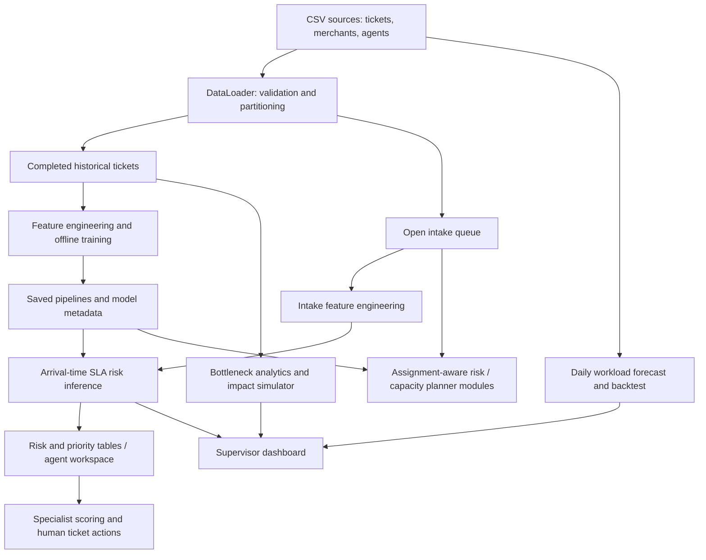

# OpsPilot AI — Complete Project and Judges' Preparation Guide

Prepared: 30 October 2026. Repository: `KrishAgarwal04/claimlens`.

This guide describes the current local implementation, including the new ticket tables. The repository is named **claimlens**, but the application is branded **OpsPilot AI**. Use “OpsPilot AI” during the presentation and explain the repository name if asked.

Saved metrics below were checked against repository evaluation reports and the active model artifact hashes. They are recorded experimental results, not a new training run or evidence of real production performance. Older README/report sections sometimes describe earlier screens or stronger archived models; the current source and active artifact reports take precedence.

## 1. Project in one sentence

### Which algorithms are actually used? Read this first

**Yes: Random Forest is the active arrival-time prediction model.** More precisely, the saved object is a `CalibratedClassifierCV` containing five fitted pipelines, each with a `RandomForestClassifier`. This was verified by loading the saved artifact, not inferred only from an import or README.

| Algorithm / technique | Current role | Active or experimental? |
|---|---|---|
| Random Forest classification | Arrival-time resolution breach probability | Active, inside the calibrated saved model |
| Sigmoid / Platt-style calibration | Adjusts Random Forest probabilities using held-out fold predictions | Active, five calibration folds |
| Logistic Regression, C=0.01 | Risk when the proposed agent is known | Active, separate assignment-stage model |
| One-hot encoding | Converts categorical features into numeric indicators | Active in both prediction pipelines |
| StandardScaler | Standardizes numeric assignment-model inputs | Active for Logistic Regression; numeric arrival inputs pass through unscaled |
| Stratified split and five-fold CV | Evaluation and candidate assessment | Training/evaluation techniques, not inference models |
| Weighted multi-criteria scoring | Specialist suitability ranking | Active recommender logic; rule-based, not a learned classifier |
| Linear sum assignment | Global capacity-constrained ticket-agent allocation | Implemented planner module; see UI-wiring caveat in Section 8 |
| Recent / weekday / exponentially weighted means | Intake-volume forecasting candidates | Implemented forecast module |
| Poisson quantiles | Approximate forecast count intervals | Implemented forecast module |
| Rolling standardized deviations | Unusual intake-volume detection | Implemented forecast module |
| Gradient Boosting / decision stumps | Assignment and arrival candidate experiments | Candidate code, not the two current active classifiers |
| Histogram Gradient Boosting | Full-profile assignment model and experiments | Archived stronger assignment profile / candidate code |
| SVC, CatBoost, VotingClassifier | Alternative arrival-model experiments | Experimental; do not claim these power the current arrival artifact |
| Ridge regression on log duration | Auxiliary duration-risk experiment | Experimental; not the active arrival classifier |
| Cross-fitted target encoding | Merchant-history experiment | Experimental; not the active 18-feature arrival pipeline |

**Presentation answer:** “Our main arrival-time model is a calibrated Random Forest, not just a generic AI model. Our separate assignment-time model is regularized Logistic Regression. Agent recommendations also use transparent weighted scoring, while forecasting uses statistical baselines.”

OpsPilot AI helps support teams identify tickets likely to miss their resolution SLA, choose suitable specialists, diagnose operational bottlenecks, and explore staffing and routing decisions through an interactive Python application.

### 30-second pitch

“Support teams often react after deadlines are missed. OpsPilot AI scores incoming tickets for SLA breach risk before an agent is assigned, combines that risk with priority and SLA urgency, and recommends specialists with clear reasons. Supervisors can examine bottlenecks, compare operational scenarios, and forecast intake. Our prototype uses synthetic support data and evaluated machine learning models; its recommendations support human decisions.”

### 90-second pitch

“A priority label alone does not tell us whether a ticket will actually miss its deadline. A P3 ticket in a difficult category can have high predicted breach risk, while a P1 ticket remains urgent even if its model score is lower.

OpsPilot AI separates these concepts. It estimates arrival-time risk from information available at intake, shows High, Medium, and Low risk groups alongside P1–P4 priorities, and tracks deadlines relative to the dataset snapshot. Agents can inspect, claim, and manage tickets. Supervisors get historical bottleneck analysis, specialist recommendations, scenario modelling, and workload forecasts.

The active arrival model is a calibrated Random Forest. A separate Logistic Regression model estimates risk when a proposed agent is known. Their original holdout accuracies are 80.39% and 85.36%, respectively, on synthetic data. We keep outcome fields out of prediction inputs and distinguish model estimates from measured operational impact. The next step is a real-data pilot with persistent workflow storage and monitored results.”

## 2. Problem, users, and value

| Item | Explanation |
|---|---|
| Problem | Reactive triage, domain mismatches, uneven specialist coverage, and limited visibility into likely SLA failures |
| Agent user | Needs a focused queue, ticket details, assignment guidance, and next actions |
| Supervisor user | Needs risk distribution, bottleneck evidence, staffing scenarios, and workload visibility |
| Predicted target | Whether a ticket breaches its **resolution** SLA |
| Decision support | Which tickets need attention and which specialist is suitable |
| Intended benefit | Earlier intervention and better-informed routing; realized improvements require a pilot |
| Current scope | CSV-backed, interactive prototype using synthetic data |

The product combines prediction, operational explanation, and an agent workflow. A conventional dashboard describes past outcomes; this prototype also estimates future risk and suggests actions.

## 3. Complete technology stack

Versions in the “local environment” column were read from the project's `.venv`; they are not claims about the latest public releases.

| Layer | Technology | Dependency declaration | Local environment | Role |
|---|---|---|---|---|
| Language | Python | No exact Python version pinned in requirements | Python 3.12 environment | Application, models, analytics, tests |
| UI and application server | Streamlit | `>=1.66.0` | 1.66.1 | Pages, widgets, tables, reactive execution, session state |
| Data processing | pandas | `>=2.0.0` | 3.1.0 | CSV ingestion, joins, filtering, aggregation, feature tables |
| Numerical computing | NumPy | `>=1.24.0` | 2.5.4 | Arrays, risk calculations, vectorized classification |
| Machine learning | scikit-learn | `==1.9.1` | 1.9.1 | Pipelines, encoding, scaling, classification, calibration, evaluation |
| Charts | Plotly | `>=5.18.0` | 7.1.0 | Interactive operational and model charts |
| Optimization and statistics | SciPy | `>=1.10.0` | 1.18.1 | Linear assignment solver, Poisson forecast intervals |
| Model serialization | joblib | `>=1.3.0` | 1.6.0 | Saved model loading and persistence |
| Date utilities | python-dateutil | `>=2.8.2` | 3.0.0 | Date-processing dependency |
| Styling | CSS and HTML | In repository | Custom styles | Layout, typography, blue actions, contrast, guidance banners |
| Data storage | CSV files | In repository | Local files | Tickets, merchants, agents, evaluation inputs |
| Model metadata | JSON | In repository | Local files | Metrics, feature lists, model selection and audit records |
| Testing | pytest and Streamlit AppTest | pytest is not listed in core requirements | pytest available outside project venv | Unit, integration, and interactive UI checks |
| Version control | Git and GitHub | External development tools | Repository remote configured | Source history and collaboration |
| Optional experiments | CatBoost and additional sklearn experiments | `requirements-training.txt` | Optional | Candidate selection and model research; not the active arrival classifier |

**Architecture boundary:** the current app uses Python modules in the Streamlit process. It does not implement a separate React frontend, FastAPI/Flask REST backend, SQL database, message broker, or LLM service. There is no demonstrated cloud deployment, Kubernetes setup, or live ticketing-service integration in this implementation.

**Reproducibility detail:** scikit-learn is pinned to match serialized model artifacts. Most other dependencies have lower bounds rather than exact pins. A fully locked environment remains a production-readiness improvement.

## 4. Architecture and data flow



The capacity planner exists in the codebase. Its availability in a screen depends on the current UI wiring; do not describe it as a separate visible AI Decision Engine tab. The current supervisor screen has six tabs, listed below.

### Important source files

| File | Responsibility |
|---|---|
| `app/main.py` | App initialization, cached data/model loading, arrival scoring, navigation, supervisor screen renderers |
| `app/agent_views.py` | Agent workspace, ticket claim/management, personal queue, profile, snapshot SLA timing |
| `app/supervisor_views.py` | Supervisor tab layout and assignment-model evidence helpers |
| `app/components/ticket_table.py` | Workspace risk classification, grouping, filtering, live session assignment/status display |
| `app/components/styles.py` | Shared visual styles and HTML components |
| `app/components/charts.py` | Operational and analytical charts |
| `app/decision_views.py` | Planning and workload display functions |
| `src/config.py` | Paths, schema constants, SLA targets, allowed/forbidden feature definitions |
| `src/pipeline/loader.py` | Input loading, validation, historical/open partition |
| `src/pipeline/features.py` | Intake features, merchant context, leakage checks |
| `src/models/sla_model.py` | Arrival-time classifier, preprocessing, calibration, model evaluation |
| `src/models/assignment_risk.py` | Proposed-agent feature construction and assignment-time inference |
| `src/models/train_assignment.py` | Compact/full assignment-model candidate selection and training |
| `src/routing/recommender.py` | Weighted specialist ranking and explanations |
| `src/routing/decision_engine.py` | Capacity-constrained global assignment optimization |
| `src/analytics/bottlenecks.py` | Historical mismatch, category, tier, shift, and load analysis |
| `src/analytics/workload.py` | Daily intake forecasting, backtest, surge detection |
| `src/simulation/simulator.py` | Historical-baseline operational scenarios |
| `tests/` | Data contracts, model, routing, simulation, and UI verification |

## 5. Data, schema, and SLA definitions

| Entity | Count | Main fields |
|---|---:|---|
| Merchants | 112 | ID, name, account tier, sector, region |
| Agents | 20 | ID, name, support tier, specialty, shift region, efficiency multiplier |
| All tickets | 2,057 | Intake fields, assignment, timing, and outcome fields |
| Completed historical tickets | 1,807 | Used for training and measured historical outcomes |
| Open queue | 250 | Scored for triage; not used as labelled training examples |

All these datasets are synthetic. Blank response, closure, and CSAT fields in open tickets are expected because the work has not completed. Do not fill those blanks with invented outcomes.

Five support domains: Payments & Checkout, API Integrations, Notifications, Fulfilment & Logistics, and Account Access. There are 20 canonical subcategories. Merchant account tiers are Foundation and Advanced; agent support tiers are L1, L2, and L3. These are different concepts.

| Ticket priority | First-response target | Resolution target |
|---|---:|---:|
| P1 | 15 minutes | 2 hours |
| P2 | 1 hour | 8 hours |
| P3 | 4 hours | 24 hours |
| P4 | 12 hours | 48 hours |

**Priority:** recorded business urgency, P1 highest. **Risk:** predicted probability of missing the resolution SLA. **SLA status:** deadline position at the dataset snapshot. These dimensions must remain separate.

Risk groups: High `p >= 0.70`; Medium `0.40 <= p < 0.70`; Low `p < 0.40`. The new workspace table labels a missing risk as Unknown. These are operational grouping thresholds, distinct from the binary evaluation threshold of `0.50`.

Workspace SLA timing uses `created_at + resolution target`, with elapsed time measured against the maximum creation timestamp in the queue. Overdue means remaining time `<= 0`; Due soon means `0 < remaining <= 4 hours`. This is a dataset-snapshot demo, not a wall-clock production SLA monitor.

## 6. Machine learning explained

### Stage A: arrival-time risk

Question: “Before we know the agent, how likely is this ticket to breach its resolution deadline?”

Active model: **Random Forest with sigmoid probability calibration**. The classifier construction uses 150 trees, depth 6, minimum leaf size 5, balanced class weights, and random seed 42. Calibration uses five-fold CV. The pipeline handles categorical fields using one-hot encoding with unknown-category handling.

The model consumes **18 raw feature columns before one-hot expansion**:

- Twelve numeric: priority rank, SLA target hours, reopen-child flag, incident flag, intake hour, day of week, weekend flag, month, hour sine/cosine, and day-of-week sine/cosine.
- Six categorical: category, subcategory, priority, merchant tier, merchant sector, and merchant region.

`ticket_id` and `merchant_id` support joins and traceability but are excluded as predictive identifiers. Cyclical sine/cosine features make times such as 23:00 and 00:00 close in feature space.

Why Random Forest: mixed structured inputs, nonlinear interactions, a small dataset, and practical CPU inference. Calibration improves how probability estimates correspond to observed outcomes; it does not guarantee perfect probabilities for each subgroup or future dataset.

### Random Forest: exact working in this project

A decision tree learns a sequence of questions about feature values. For example, it might split on a category indicator, SLA target, or incident flag. A leaf contains training examples with some mixture of breaches and non-breaches, from which the tree estimates a breach probability. This is an illustrative explanation, not a transcription of a specific fitted tree's rules.

A Random Forest trains many trees on bootstrap samples, with random subsets of features considered at each split. Individual trees can disagree. For classification probabilities, sklearn averages their probability estimates; describing this only as “majority voting” misses how this project obtains its risk scores.

Simplified raw forest calculation:

`p_raw(breach | ticket) = average(tree_1_probability, ..., tree_150_probability)`

The app then uses the calibrated model's probability rather than presenting that raw average directly. Calibration and fold averaging are explained below.

| Saved forest parameter | Value verified from artifact | Meaning |
|---|---|---|
| `n_estimators` | 150 per fitted forest | Number of trees in each forest |
| `max_depth` | 6 | Limits each tree's depth to constrain complexity |
| `min_samples_leaf` | 5 | Requires at least five training examples in a leaf |
| `class_weight` | `balanced` | Weights classes inversely to their training frequencies |
| `random_state` | 42 | Makes randomized training reproducible within a compatible environment |
| `bootstrap` | `True` | Uses sampled-with-replacement training rows for individual trees |
| `max_features` | `sqrt` | Considers roughly the square root of available encoded features at each split |
| `criterion` | `gini` | Chooses splits using Gini impurity reduction |

The saved calibration wrapper has **five fitted forest pipelines**, each containing 150 trees: 750 trees across the wrapper's fitted ensemble. Say “150 trees per forest, five calibration folds” if a judge asks about the exact deployed object. Do not say there is only one 150-tree object in that wrapper.

Gini impurity is `1 - sum(class_probability²)`. A node containing almost entirely one class has low impurity. Tree training searches candidate feature splits for reductions in weighted child-node impurity.

Bootstrap sampling and feature randomness reduce correlation between trees. Averaging reduces variance compared with relying on one unstable tree. Depth and leaf-size restrictions further constrain overfitting, but the forest can still learn synthetic-data artifacts and fail on a changed distribution.

### Probability calibration: the step after the forest

The saved object uses `CalibratedClassifierCV(method="sigmoid", cv=5)`. Within the training partition, base pipelines are trained on fold subsets and sigmoid calibrators learn from held-out fold predictions. The saved artifact contains five fitted calibrated classifiers; inference combines their calibrated probabilities.

A sigmoid calibration mapping can be written as `1 / (1 + exp(A × score + B))`, with A and B fitted from calibration data. It is a learned mapping, not a manually chosen percentage correction.

Hypothetical example: a raw forest score of 0.90 might map to 0.82 after calibration. The direction and amount depend on the fitted mapping; these numbers are illustrative, not a measured ticket from this dataset.

The repository's original holdout Brier score is approximately **0.1530 for the uncalibrated forest** and **0.1390 for the calibrated forest**. Lower is better. These reported values support lower probability error on that holdout; they do not establish perfect future calibration.

Distinguish two uses of CV: training-only candidate benchmarking compares classifiers, whereas internal calibration CV fits the probability wrapper. The original 362-ticket holdout stays outside both fitting procedures.

### Preprocessing: what the model actually receives

Raw strings cannot be supplied directly to this sklearn forest. `ColumnTransformer` sends six categorical fields through `OneHotEncoder(handle_unknown="ignore", sparse_output=False)` and passes twelve numeric arrival features through without scaling.

Illustrative category encoding:

| Category | API Integrations indicator | Notifications indicator | Account Access indicator |
|---|---:|---:|---:|
| API Integrations | 1 | 0 | 0 |
| Notifications | 0 | 1 | 0 |

The table shows only three illustrative indicator columns, not the full schema. The first fitted arrival pipeline in the current saved wrapper has **52 transformed columns**. The raw input count remains 18; encoding expands it. A newly trained artifact can have a different encoded count if categorical coverage changes.

One-hot encoding avoids inventing an order between categories such as API Integrations and Notifications. Unknown categories become an all-zero indicator block for that field, allowing inference to run; this does not establish trustworthy accuracy on unseen categories.

The Logistic Regression pipeline additionally applies `StandardScaler` to numeric fields: `z = (x - training_mean) / training_standard_deviation`. Training-derived scaling is reused at inference. Tree splits generally do not require this scaling; regularized linear-model coefficients are sensitive to feature scales.

### Walk through one ticket end to end

1. Read a ticket's existing priority, category, timestamps, flags, and merchant ID.
2. Join merchant tier, sector, and region; compute intake-time and SLA features.
3. Select the 18 allowed arrival-model inputs. Do not include future resolution information.
4. Transform the inputs using the saved pipeline and obtain calibrated breach probability.
5. Suppose the output is 0.82: label it High risk because it exceeds 0.70. Its original P3 priority, if P3, remains P3.
6. Independently compute whether its deadline is overdue, due soon, or within SLA at the snapshot.
7. Rank specialists using the recommender. If a proposed agent is supplied to the separate assignment model, build its 26-input matrix and obtain an assignment-stage risk estimate.
8. Display the evidence and let the operator act. Session-only updates do not retrain the model or rewrite the source CSVs.

The 0.82 example is hypothetical. Do not present it as a saved prediction unless you actually inspect a ticket with that score.

### Stage B: assignment-aware risk

Question: “If this particular agent handles the ticket, what breach risk does the model estimate?”

Active model: **regularized Logistic Regression, C=0.01**, fixed decision threshold 0.50. Numeric inputs are scaled and categorical inputs are one-hot encoded.

Logistic Regression computes a weighted linear score `z = intercept + sum(weight_i × transformed_feature_i)` and maps it to probability using `p = 1 / (1 + exp(-z))`. Despite its name, it is used here for binary classification. A positive coefficient increases log-odds when other transformed features are held fixed; it does not prove a causal effect. Regularization penalizes large coefficients, and C controls inverse regularization strength.

Its classification sigmoid is different from the separately fitted sigmoid calibration wrapper around the arrival forest. The saved assignment pipeline is a `Pipeline(..., LogisticRegression(C=0.01, max_iter=2000))`; it is not stored inside that forest's calibration wrapper.

### Experimental algorithms: what each one was for

| Algorithm | Basic idea | Where to inspect | Claim boundary |
|---|---|---|---|
| DummyClassifier | Predict the most frequent training class | `src/models/sla_model.py` | Baseline, not the deployed risk model |
| GradientBoostingClassifier | Add trees sequentially to improve the current loss | `src/models/improvement.py`, `train_assignment.py` | Includes shallow stump candidates; active assignment model is still Logistic Regression |
| HistGradientBoostingClassifier | Histogram-binned features and sequential boosted trees | `src/models/train_assignment.py` | Earlier full assignment profile used this; archived scores belong to that artifact |
| SVC | Learn a separating margin, including nonlinear kernel boundaries | `src/models/refine.py` | Experiment, not active arrival inference |
| CatBoostClassifier | Gradient boosting library used for alternative tabular pipelines | `src/models/improvement.py` | Optional dependency and experimental candidate |
| VotingClassifier | Combine several candidate estimators' outputs | `src/models/improvement.py` | Experiment; do not confuse it with individual trees in Random Forest |
| DurationRiskClassifier + Ridge | Fit log resolution duration, estimate residual spread, derive breach tail probability at an SLA | `src/models/duration_risk.py` | Uses completed durations as auxiliary training targets, not inference inputs; experimental distribution assumptions |
| TargetEncoder merchant context | Learn smoothed target-related merchant-history representations with cross-fitting | `src/models/merchant_context.py` | Optional experiment; must avoid future-history leakage |

Random Forest trains randomized trees that can be built independently. Boosting trains sequential stages that correct the current ensemble's loss. An import or candidate definition proves implementation availability, not promotion to the active artifact.

It uses the same 18 intake fields plus eight proposed-agent fields: efficiency, tier rank, domain match, region match, capability gap, tier, specialty, and region. Total: **26 raw inputs**, not 26 final one-hot columns.

Proposed-agent metadata is known at assignment planning time. The observed post-assignment `category_mismatch` field is not used; domain match is recomputed from known ticket and directory attributes.

The compact model was selected from seven candidates to be near 85% training-CV accuracy, within an earlier requested 80–90% band. This is a deliberately constrained prototype choice, not proof of the best possible model. A production choice should optimize actual operational costs, calibration, stability, and validation performance. A stronger older full-profile model is archived; its scores must not be presented as the active model's scores.

### Leakage prevention and evaluation protocol

1. Partition completed history from the open queue before supervised modelling.
2. Use the original 80/20 stratified split: 1,445 training tickets and 362 holdout tickets, random state 42.
3. Compare candidates with five-fold training-only cross-validation.
4. Fit preprocessing within model pipelines, avoiding test-data fitting.
5. Keep response timestamps, response time, resolution duration, closure timestamp, breach labels, CSAT, and post-resolution reopen outcomes out of inference features.
6. Use `resolution_breached` as the label, not an input.
7. Evaluate saved models on separate synthetic datasets; reports record model hashes and audit checks.

The original holdout is stratified, not a chronological split. Separate evaluation data is later-dated synthetic data, but has already been examined during project development. Do not call it a never-seen production validation set. No overlap of ticket IDs alone proves neither independence nor the absence of every possible form of leakage.

## 7. Verified results: numbers to use during judging

| Dataset | Tickets | Arrival accuracy | Active assignment accuracy |
|---|---:|---:|---:|
| Original historical holdout | 362 | 80.39% | 85.36% |
| Separate evaluation | 300 | 73.67% | 87.33% |
| V2 evaluation | 500 | 79.00% | 88.80% |
| V3 evaluation | 500 | 76.80% | 86.00% |

These are two prediction stages with different available information, not a controlled comparison of algorithms on identical inputs.

| Original holdout metric | Arrival model | Active assignment model |
|---|---:|---:|
| ROC-AUC | 0.8840 | 0.9424 |
| PR-AUC | 0.9200 | 0.9572 |
| Breach precision | 80.44% | 87.08% |
| Breach recall | 87.02% | 87.50% |
| F1 | 0.8360 | 0.8729 |
| Brier score, lower better | 0.1390 | 0.1172 |
| True negatives | 110 | 127 |
| False positives / false alarms | 44 | 27 |
| False negatives / missed breaches | 27 | 26 |
| True positives / detected breaches | 181 | 182 |

Arrival accuracy: `(110 + 181) / 362`. Assignment accuracy: `(127 + 182) / 362`. An always-breach baseline scores approximately 57.46% accuracy on this holdout.

Explain metrics: precision asks how many alerts were correct; recall asks how many actual breaches were caught; ROC-AUC measures ranking across thresholds; PR-AUC focuses on the positive class; Brier score measures probability error. ROC-AUC 0.8840 does **not** mean 88.40% accuracy.

The active assignment model's holdout accuracy interval is approximately 81.35–88.63% (95% Wilson interval). Its V3 accuracy interval is approximately 82.68–88.77%. There is no single guaranteed project-wide accuracy number.

Evidence: `models/model_metadata.json`, `docs/model_accuracy_results.json`, `docs/assignment_accuracy_results.json`, `docs/evaluation_v2_results.json`, and `docs/evaluation_v3_results.json`. The saved arrival and assignment artifact hashes matched these current reports when this guide was prepared. Metrics were not regenerated for this documentation task.

## 8. Routing, planning, analytics, and forecasting

### Explainable specialist recommender

The heuristic match score is:

`0.50 × domain fit + 0.25 × tier/priority fit + 0.15 × normalized efficiency + 0.10 × region fit`

This score ranks suitability; it is **not a calibrated success probability**. Weights are transparent design choices that should be validated operationally. The module includes deterministic tie-breaking, fallback handling, and historical context. Its heuristic scoring is separate from the assignment-risk ML model.

### Capacity-constrained planner module

The planner scores ticket-agent pairs and uses SciPy's `linear_sum_assignment` over agent-capacity slots and waiting slots. Its constraints include domain compatibility, L2/L3 eligibility for P1/P2, and operator-entered capacity budgets.

The cost combines priority weights (P1=8, P2=5, P3=2, P4=1), merchant impact (Advanced=1.5, Foundation=1), estimated assignment risk, and a small slot-depth penalty. Waiting has an explicit penalty. The solver optimizes this encoded cost matrix, not every real-world service objective.

It compares against an eligibility- and capacity-matched reference policy. Already-overdue tickets are treated as existing breaches for planning; reassignment cannot undo an elapsed deadline. Agent budgets are planning assumptions, not measured live availability. If no eligible capacity exists, tickets remain waiting.

**UI caveat:** the planner and its rendering functions exist, but the current supervisor callback renders the Smart Agent Dispatch screen. The separate Decision Engine callback is passed through but is not invoked as a seventh tab. Demonstrate only controls actually visible in the current app.

### Bottleneck analysis

Historical analysis covers category mismatch, category/subcategory hotspots, priority, agent load, tier, shift region, merchant segments, and intake patterns. Completed history provides measured outcome denominators; open tickets must not inflate historical breach or CSAT rates. Small groups need sample-size context. Association between mismatches and breaches is not causal proof.

### What-if simulator

The simulator compares historical baselines with mismatch-reduction and staffing scenarios. It estimates recoverable hours and capacity value, with a default loaded-hour assumption of **$45/hour**. This is an explicit scenario input, not verified company cost. Recovered hours multiplied by hourly value represent capacity value, not automatically cash savings. Additional headcount enables capacity; it does not automatically create an arbitrary breach-rate reduction.

### Workload forecasting

Daily creation counts include zero-arrival dates. Candidate methods are recent 28-day mean, weekday mean from recent history, and a span-14 exponentially weighted adaptive mean. Earlier rolling validation selects a method; the final 28 days form the rolling backtest. Forecast horizon is 1–30 days. The module reports MAE against a recent-mean baseline, 80% Poisson intervals, and intake surges at three or more prior-history standard deviations.

Intervals assume independent counts and omit model uncertainty. Abrupt incident surges can exceed them. The saved evaluation narrative records a baseline-matching MAE of about 10.28 tickets/day, not a forecast improvement. Read the currently displayed backtest values for a live presentation.

## 9. Current screens and ticket tables

| Screen | What to show |
|---|---|
| My Workspace | Urgent ticket, recommended work, assigned cards, guidance, grouped ticket table, selected action panel |
| My Tickets | Personal assigned queue, search/filter, ticket management |
| Supervisor View | Executive Overview, SLA Risk Predictor, Operational Bottlenecks, Smart Agent Dispatch, What-If Simulator, Workload Forecast |
| Agent Profile | Active specialist selection and domain/workload context |

The workspace table supports risk/priority/SLA grouping, independent filters, colored risk labels, breach probability bars, assigned agent, status, and recommended action. Empty results show a clear message. It reads live ticket assignment/status from session state.

The Supervisor Executive Overview table now defaults to **All 250 intake tickets**, with All/High/Medium/Low options showing counts and a P1–P4 filter. A High-only view intentionally shows only High rows. The underlying model risk does not change when the user filters the display.

Ticket claims, notes, and status changes use Streamlit session state. They are session-level prototype actions, not durable multi-user writes to a shared database. Supervisor intake analytics are built from source CSVs, so do not promise that every supervisor chart synchronizes with every session-only action.

## 10. Five-minute demo script

| Time | Action | Explain |
|---|---|---|
| 0:00–0:30 | Introduce problem and users | Priority alone misses risk and routing context |
| 0:30–1:15 | Supervisor → Executive Overview | Show All, High, Medium, Low counts; pick P1; clear filter |
| 1:15–2:00 | SLA Risk Predictor | Explain arrival model, feature timing, holdout metrics |
| 2:00–2:50 | My Workspace | Inspect a ticket, explain specialist fit, claim it, show My Tickets |
| 2:50–3:35 | Operational Bottlenecks / Smart Agent Dispatch | Show evidence and suitability reasons; separate heuristic score from probability |
| 3:35–4:15 | What-If Simulator | Change one assumption; describe estimated capacity impact |
| 4:15–4:45 | Workload Forecast | Show baseline/backtest and interval limitations |
| 4:45–5:00 | Close | Synthetic-data prototype; next step is a monitored real-data pilot |

Before presenting: run from the repository root, confirm saved models load, clear stale table filters, verify all three risk groups, and remember which agent is active. Avoid retraining during the demo. If asked to show a backend or database, explain the current Python-module/CSV architecture directly.

## 11. Judges' cross-questions and ready answers

### Product and originality

**1. What exactly are you solving?**
Early identification of tickets likely to miss resolution SLAs, plus specialist-routing and operational-planning support for agents and supervisors.

**2. Why not just sort by P1, P2, P3, and P4?**
Priority encodes urgency, whereas breach risk also reflects category, context, and timing patterns. We show both rather than replacing urgency with the model score.

**3. Can a P4 ticket be High risk?**
Yes. A less urgent ticket can still be likely to miss its longer deadline. High predicted risk does not change its recorded priority automatically.

**4. What makes this different from a ticket dashboard?**
It combines pre-assignment prediction, specialist suitability, actionable agent flows, historical diagnosis, and scenario analysis. We have not established that commercial products lack these features.

**5. Is this generative AI or ChatGPT?**
No. Its current intelligence comes from supervised tabular ML, transparent scoring rules, optimization, and statistics. Guidance text is assembled from ticket facts and rules.

**6. Who pays for it and what is the business model?**
A possible future customer is a support operation or merchant platform. A team subscription or per-agent model is a hypothesis; pricing, willingness to pay, and adoption have not been validated.

### Stack and architecture

**7. Why Streamlit instead of React?**
It provides interactive Python UI close to the data and models, which suits this prototype. A separate frontend/API becomes attractive when persistent workflows, access control, and scale require it.

**8. What is your backend and database?**
The backend logic is Python running within Streamlit. Source data is CSV; models use joblib and metadata uses JSON. A production database is not implemented.

**9. Is this truly real-time?**
Scoring and display are interactive on the loaded queue. Inputs are a static dataset snapshot, without live webhook ingestion or a continuously updated production clock.

**10. What persists after refresh or restart?**
Source CSVs and model artifacts persist on disk. Ticket workflow changes use session state and are not durable shared records. Refresh/session restart behavior must not be described as database persistence.

**11. How would two agents avoid claiming the same ticket?**
The production solution needs transactional ownership updates and conflict checks in shared storage. Session-state claims alone do not enforce cross-user locking.

**12. Why are models saved rather than trained on every click?**
Offline training makes inference predictable and separates training from operations. Streamlit caches loading. The current arrival loader has a train-on-load-failure fallback; production should replace broad fallback behavior with explicit model validation and controlled recovery.

### Data and model design

**13. Where did the data come from? Is it real?**
The repository contains synthetic merchant, agent, and support-ticket datasets. We do not present the results as real customer or enterprise outcomes.

**14. Why are open tickets excluded from training?**
Their final outcomes are unknown. Treating placeholders as real labels would corrupt learning and evaluation.

**15. What is the target variable?**
`resolution_breached`, indicating whether completed resolution exceeded the priority-specific resolution SLA.

**16. Why Random Forest?**
It handles nonlinear interactions in structured data and is practical for the dataset size. We compared it with simpler baselines and calibrated the selected classifier's probabilities.

**17. Why a second Logistic Regression model?**
Once a proposed agent is known, additional legitimate features become available. A separate stage makes that information boundary explicit and supports assignment scenarios.

**18. Why not deep learning?**
The data is small and tabular. Simpler models are easier to evaluate and operate here. We have no evidence that deep learning would improve this task.

**19. What is calibration?**
It adjusts probability estimates toward observed event frequencies. We evaluate probability error with Brier score; calibration is not a promise that every 80%-scored ticket will breach.

**20. What does C=0.01 mean?**
In Logistic Regression, smaller C means stronger regularization. It constrains coefficient magnitude and was part of the documented compact-profile selection.

**21. Why intentionally target around 85% CV accuracy?**
That constraint came from an earlier prototype requirement. It trades away performance and is not a production selection principle. We preserve the decision openly and would revisit it using operational costs and fresh validation.

**22. Are 18 features the same as 18 encoded columns?**
No. Eighteen is the number of raw model input fields. One-hot encoding expands categorical inputs into additional numerical columns.

**23. Does using an agent's efficiency cause leakage?**
The assignment stage uses a supplied directory attribute available before work starts. In production that rating must be computed only from prior data. A rating calculated using future outcomes would introduce leakage.

**24. What is the difference between is_reopen_child and is_reopened?**
The first identifies an intake record already known to be a reopen follow-up. The second records a later reopen outcome and is excluded from arrival prediction inputs.

**25. How do you handle unknown categories?**
One-hot encoding ignores unseen category levels rather than raising an encoding error. The model can still be unreliable on unfamiliar distributions; detect and monitor them instead of promising robust generalization.

### Evaluation and credibility

**26. What is your accuracy?**
Specify stage and dataset: arrival model 80.39% and active assignment model 85.36% on the original 362-ticket holdout. On V3, they score 76.80% and 86.00%.

**27. Why not quote 92.80%?**
That is an archived stronger assignment model's V2 result. The active compact assignment model scores 88.80% on V2. We separate active and archived evidence.

**28. Does ROC-AUC 0.884 mean 88.4% accuracy?**
No. ROC-AUC measures ranking across thresholds. Arrival-model accuracy on the original holdout is 80.39% at threshold 0.50.

**29. Why measure recall?**
Missing an actual breach can delay intervention. Recall measures the share of breaches detected; precision measures false-alert burden. Threshold choice should balance both costs.

**30. Why is a 70% risk cutoff different from a 50% prediction threshold?**
The 50% threshold produces binary evaluation labels. The 40% and 70% cutoffs create operational Low/Medium/High groups. They serve different purposes.

**31. How do you prevent data leakage?**
Enforce feature allowlists and forbidden-field checks, exclude open outcomes, keep identifiers out of model inputs, fit preprocessing inside CV pipelines, and reserve holdout data for evaluation. These controls reduce specified leakage risks; they are not a mathematical proof against every leakage source.

**32. Was your original split time-based?**
No. It is an 80/20 stratified split with seed 42. Later-dated synthetic evaluations offer additional evidence, but a fresh temporal operational holdout is still needed.

**33. Are the external evaluations independently collected?**
They are separate synthetic files with overlap and consistency audits. They have already been examined during development, so we should not describe them as blind real-world validation.

**34. Why does performance fall on some datasets?**
Different distributions and limited model information affect generalization. We report the decline rather than replacing it with the strongest benchmark.

**35. Can you guarantee that High-risk tickets breach?**
No. Risk is a probability estimate, and false alarms occur. The table supports attention allocation; it does not know future outcomes.

### Routing, forecasting, and business impact

**36. Is a 90% specialist match score a 90% success probability?**
No. It is a weighted suitability score. Calibrated breach probability comes from a different model.

**37. Why those routing weights?**
They prioritize domain fit, then seniority, efficiency, and regional fit. They are explicit design assumptions, not learned coefficients or globally optimal operational values.

**38. How does the global planner handle overload?**
Capacity slots restrict assignments and waiting slots retain feasibility. Urgent tickets receive larger deferral penalties. Unassigned work remains visible rather than exceeding declared capacity.

**39. Does the optimizer guarantee the best business outcome?**
It finds the minimum of the encoded assignment cost under the stated constraints. Model error, inaccurate budgets, omitted dependencies, and operational realities limit that guarantee.

**40. Can reassignment fix an already-breached SLA?**
It can support recovery, but cannot undo the missed deadline. The planner marks past-deadline tickets as existing breaches.

**41. Do you know agents' live availability?**
No. Directory attributes and operator-entered budgets are used. Production needs schedule, current load, leave, concurrency, and real queue integrations.

**42. Does reduced predicted risk prove routing caused fewer breaches?**
No. Alternative-assignment predictions are observational scenario estimates. A controlled pilot or carefully designed causal evaluation is required.

**43. Are simulator savings real money?**
The simulator estimates recovered capacity under assumptions. Capacity value becomes cash savings only if staffing, overtime, contracts, or other actual spending changes.

**44. What forecasting model do you use?**
Recent mean, weekday mean, and an exponentially weighted adaptive mean are compared with rolling validation. We report final-window MAE and a baseline comparison.

**45. Why not Prophet, LSTM, or an LLM forecast?**
We start with transparent statistical baselines. More complex forecasting should be justified by backtested improvement, especially under incident-driven changes.

**46. What happens during a sudden incident surge?**
The anomaly detector may flag unusual volume, but simple forecasts and Poisson intervals can understate the surge. The dashboard exposes this limitation; production needs incident-aware inputs and escalation procedures.

### Production, security, and testing

**47. Is selecting Agent Profile secure login?**
No. It is a demo identity switcher. Authentication and server-enforced role permissions must be added for deployment.

**48. Is it production-ready?**
It is a working prototype. Durable storage, authentication, authorization, concurrent assignment control, audit logging, real integrations, monitoring, and operational validation remain.

**49. How would you integrate Jira, Zendesk, or ServiceNow?**
Add an authenticated ingestion adapter/API or webhook, map source records to the validated schema, store workflow state transactionally, and send approved changes back with idempotency and audit logs. Those integrations are proposed, not implemented.

**50. How would you scale it?**
Separate ingestion, storage, prediction, and UI; batch/cache predictions; use a shared database and background jobs. Benchmark first. Pairwise assignment considers ticket-agent combinations, and capacity-slot optimization needs bounded batches or a different formulation at larger scale.

**51. How do you secure saved models and sensitive ticket data?**
Load joblib artifacts only from trusted sources because deserialization can execute code. A production setup needs access controls, artifact verification, secret management, encryption, retention limits, and appropriate removal of sensitive fields. These are deployment requirements, not completed controls.

**52. How do you monitor drift and fairness?**
Track input distributions, unknown categories, calibration, recall, and outcome delays over time, with breakdowns by priority, category, region, and merchant tier. The current app does not implement an automated production monitoring service or a comprehensive fairness audit.

**53. What tests did you perform?**
The repository includes pipeline, model, routing, simulator, contract, and AppTest tests. During the recent workspace-table change, 28 selected table/UI tests passed. After the supervisor filtering fix, four ticket-table tests passed, including actual supervisor All/High/Medium/Low and priority interactions. This is not a claim that the entire repository suite was rerun for this guide.

**54. What is your biggest limitation?**
Validation on synthetic data cannot establish performance on real operations. Session-only workflow state is also a major deployment gap. A monitored real-data pilot is the next evidence-generating step.

**55. What is your roadmap?**
First durable workflow storage, secure identity, and actual ticket ingestion; then fresh temporal validation and probability calibration checks; then a human-supervised pilot and drift monitoring; finally scale and richer forecasting if evidence supports it.

### Algorithm-specific follow-up questions

**56. Why is it called Random Forest?**
It combines many decision trees trained with randomized row samples and feature choices. Their combined estimates reduce dependence on any single tree.

**57. Does your forest use voting or averaging?**
For the probability this app needs, sklearn averages individual trees' class-probability estimates. The calibration wrapper then combines calibrated fold-model outputs. A final threshold can turn probability into a class.

**58. What is bagging?**
Bootstrap aggregating trains models on samples drawn with replacement and combines their predictions. Random Forest also randomizes feature choices at splits to reduce tree correlation.

**59. Why not use one decision tree?**
A single tree can change substantially with small training-data changes. Averaging decorrelated trees typically reduces variance, at the cost of more computation and less compact explanations.

**60. Which hyperparameters prevent overly complex trees?**
This forest uses maximum depth 6 and minimum leaf size 5. These constrain tree complexity. They reduce an overfitting risk but do not prove the model generalizes to real data.

**61. Why exactly 150 trees?**
It is the implementation's configured value, not a proven universal optimum. The core baseline pipeline does not establish 150 as the result of an exhaustive tree-count search. Future tuning should compare cost and training-CV performance.

**62. How many trees are actually loaded?**
The inspected calibrated artifact contains five fitted forest pipelines with 150 trees each: 750 trees across the wrapper. Each forest has the same configured hyperparameters but was fitted through its calibration-fold process.

**63. What does class_weight="balanced" do?**
It weights each class inversely to its frequency in the training subset. It does not create new samples and is different from oversampling or SMOTE. The project does not need to claim SMOTE to explain this model.

**64. Why is StandardScaler used for Logistic Regression but not the forest?**
Regularization acts on coefficient sizes, so numeric scale affects a regularized linear model. Tree thresholds depend on ordering and generally do not need standardization. The saved pipelines implement that difference.

**65. Did calibration increase accuracy?**
On the recorded holdout, uncalibrated forest accuracy is `(133 + 160) / 362 = 80.94%`; calibrated accuracy is `(110 + 181) / 362 = 80.39%`. Calibration improved Brier score and breach recall in those reports, not accuracy. Its purpose is probability quality, and these tradeoffs should be stated honestly.

**66. Are feature importances explanations for one ticket?**
No. Global forest impurity importances summarize training split behavior and can be biased. The core arrival metadata extracts them from a separately fitted base forest, not a causal explanation of each calibrated prediction. Ticket recommendation reasons are mostly rules and directory facts. We do not implement SHAP-based local forest explanations here.

**67. Why do you say the model was selected if the core script fixes random_forest?**
The script benchmarks candidate algorithms, but `self.model_type` determines which fitted pipeline is used. The app's fallback explicitly requests Random Forest. Do not claim the core script automatically chooses the highest-scoring algorithm unless describing a separate experiment-selection command.

**68. Is Gradient Boosting the same as Random Forest?**
No. Forest trees are randomized ensemble members; boosting stages are added sequentially to improve loss. Both use trees but learn and combine them differently.

**69. How do you prove an algorithm is active?**
Trace inference to the artifact path, inspect its loaded estimator classes and parameters, and match its hash to evaluation reports. Listing imports or optional dependencies is insufficient.

**70. What should you say if asked to explain all the AI in this project?**
“We use calibrated Random Forest for arrival risk, Logistic Regression for proposed-agent risk, explicit weighted rules for specialist ranking, linear assignment optimization in the planner module, and statistical means, Poisson intervals, and rolling surge detection for workloads. The repository also contains alternative model experiments, which are separate from active inference.”

## 12. Setup, evaluation, and troubleshooting

Run these PowerShell commands from the repository root:

```powershell
python -m venv .venv
.\.venv\Scripts\python.exe -m pip install -r requirements.txt
.\.venv\Scripts\python.exe -m streamlit run app/main.py
```

For the screenshot's port, append `--server.port 8511`; otherwise Streamlit uses its normal available default port.

Evaluate saved artifacts without deliberately retraining:

```powershell
.\.venv\Scripts\python.exe -m src.models.evaluate
.\.venv\Scripts\python.exe -m src.models.evaluate_assignment
.\.venv\Scripts\python.exe -m src.models.evaluate_dataset --dataset evaluation_tickets_v2.csv --name evaluation_v2
```

These evaluation commands can regenerate report outputs; use a clean checkout or review Git differences afterward. Keep original datasets and active artifacts intact for judging.

Install the test runner separately, since core requirements do not include pytest:

```powershell
.\.venv\Scripts\python.exe -m pip install pytest
.\.venv\Scripts\python.exe -m pytest tests/test_ticket_table.py tests/test_ui_components.py -q
```

Optional assignment retraining, which changes model artifacts and should not be done casually before a demo:

```powershell
.\.venv\Scripts\python.exe -m src.models.train_assignment --profile compact
```

| Symptom | Explanation / action |
|---|---|
| Only High rows appear | Choose All in Supervisor Overview; clear priority/risk filters. High-first sorting can also put other groups below the visible viewport. |
| My Tickets is empty | The currently selected agent has no session assignments; claim an eligible ticket. |
| Dates look old or future-dated | The app uses synthetic dataset dates and a snapshot clock. |
| Model-loading version warning | Use the project's environment and required sklearn version; verify artifact compatibility. |
| Workflow changes disappear | They are stored in session state, without durable database persistence. |
| README mentions a default Decision Engine page | That describes an older UI; current navigation starts in My Workspace. |
| Pandas deprecation warnings during tests | Existing analytics code emits warnings in the current environment; passing tests do not remove the need for dependency maintenance. |

## 13. Production roadmap and validation plan

1. **Workflow foundation:** PostgreSQL or another suitable transactional store, durable assignments/notes, ownership conflict checks, audit history, authentication, and role permissions.
2. **Operational ingestion:** real ticketing adapters, schema mapping, event timestamps/timezones, actual service calendars, and live agent availability.
3. **Model validation:** new real-data temporal holdout; subgroup performance and calibration checks; cost-based thresholds; reliable historical-only agent ratings.
4. **Controlled pilot:** compare against existing routing, track time-to-first-response, resolution breach rate, alert burden, workload distribution, and override reasons.
5. **Monitoring:** drift alerts, delayed-label evaluation, artifact versioning, controlled retraining, rollback, and incident handling.
6. **Scale:** benchmark the UI and optimizer, precompute repeated inference, introduce background processing and bounded planning batches as required.

These are proposed steps, not existing project integrations or deployed infrastructure.

## 14. Final revision sheet

| Remember | Correct statement |
|---|---|
| Project name | OpsPilot AI; GitHub repository is claimlens |
| Data | Synthetic; 2,057 tickets = 1,807 historical + 250 open |
| Entities | 112 merchants, 20 agents, five domains |
| Target | Resolution SLA breach |
| Arrival model | Calibrated Random Forest; 18 raw inputs |
| Assignment model | Active compact Logistic Regression C=0.01; 26 raw inputs |
| Original holdout accuracy | Arrival 80.39%; assignment 85.36% |
| V3 accuracy | Arrival 76.80%; assignment 86.00% |
| Risk bands | Low <40%; Medium 40–<70%; High ≥70% |
| Evaluation threshold | 50%, distinct from risk bands |
| SLA resolution targets | P1 2h; P2 8h; P3 24h; P4 48h |
| Recommender | Weighted suitability, not probability |
| Planner | Capacity-constrained linear assignment module; verify actual visible UI |
| State | CSV inputs plus session-only workflow updates |
| Clock | Dataset snapshot, not live wall-clock monitoring |
| ROI | Scenario capacity value, not proven cash savings |
| Main next step | Secure persistent workflow plus a monitored real-data pilot |

Suggested closing line: “We make SLA risk visible early and connect it to practical support actions. The prototype demonstrates that workflow; our next milestone is to validate its operational impact on fresh real data.”
